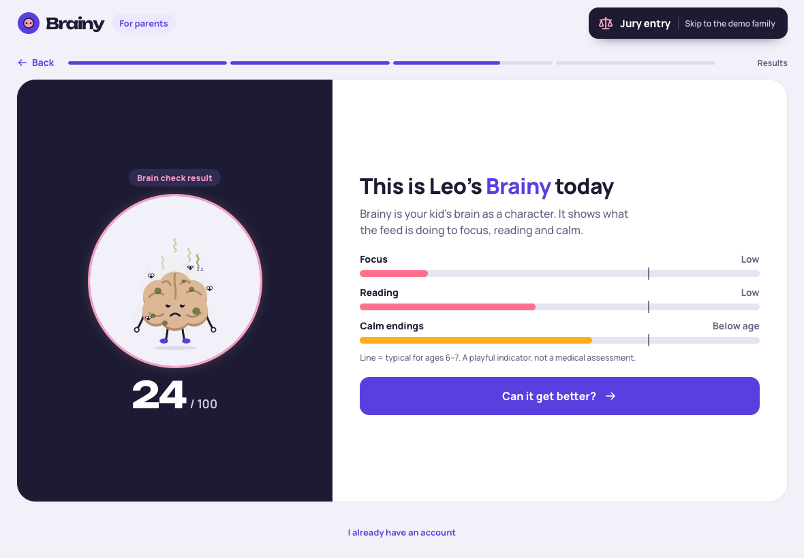
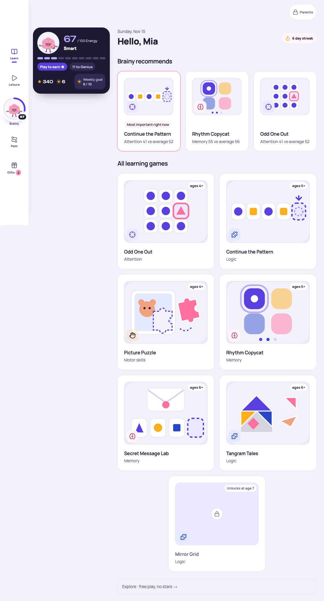
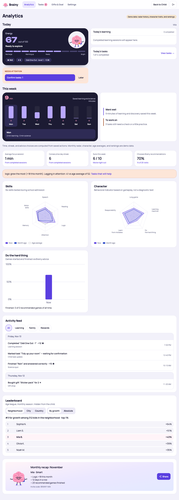

# Brainy

**A learning companion for kids 4–10 that replaces the endless feed with a bounded next tap.** The parent sets Brainy up as the only thing the child's device opens. Kids earn ★ stars in learning games and spend them on fun; they earn ☀ suns for real-life tasks the parent confirms and spend them on gifts. Their mascot, **Brainy**, visibly grows as their skills improve, and parents see what was learned.

Business Cup 2.0 hackathon project · US-first, English-only.

**Try it:** [brainee.vercel.app](https://brainee.vercel.app). Start with the **Brain Check**: quiz → result → plan → Start → Starter Pack → first game. Short on time? The subtle **Jury entry** shortcut creates your own prepared demo family in one tap (parent PIN `1234`).

| Brain Check result | Child: Learn | Parent: Analytics |
|---|---|---|
|  |  |  |

Walkthrough videos, recorded from a local production build: [iPad](docs/reports/videos/mvp/ipad-mvp.mp4) · [phone](docs/reports/videos/mvp/phone-mvp.mp4) · [learning loop (iPad)](docs/reports/videos/learning/ipad-learning.mp4). Every page with phone and iPad screenshots: [docs/reports/mvp.md](docs/reports/mvp.md).

## The problem

Short videos and endless feeds train children for constant stimulation. Parental controls limit screen *time*, not what that time is spent on, and they end in a fight when the timer runs out.

## What Brainy does

- **Brain Check funnel** (`/start`): a one-minute quiz for parents with a live brain meter, a result shown as their child's Brainy, a plan builder and an offer with display-only prices (no payment is taken).
- **Child app**: seven scored learning games that move six skills (speech, reading, logic, attention, memory, fine motor), Explore previews, interactive films with questions, a fun-game shop paid in ★, Brainy's wardrobe, a weekly Path and an explicit stopping point after every activity.
- **Two currencies**: ★ from learning, spent on entertainment; ☀ from parent-confirmed real-life tasks, spent on parent gifts.
- **Parent cabinet** (PIN): Today/Week analytics from saved sessions, tasks to confirm, gifts and a weekly goal, the family plan and device pairing. Live sync between devices by polling.
- **Product rules**: no feeds, autoplay or "watch next"; children never see rankings; Brainy never dies; no medical claims. Everything loads from our own domain so the app works under iOS Screen Time "Allowed Websites Only".

What is live and what is illustrative is labelled in the app: saved actions and activity analytics are real; historical radars and the ranking are demo data.

## Run it locally

Needs Node.js ≥ 22.13 and pnpm 11.23.0. No Docker, database server or accounts.

```bash
pnpm install
pnpm demo        # builds the games, seeds data/dev.db, starts http://localhost:3000
```

Parent PIN `1234`. Tests and checks: `pnpm check`, `pnpm test`, `pnpm e2e`. Full command list and environment variables: [docs/dev/setup.md](docs/dev/setup.md).

## How it is built

TypeScript monorepo (pnpm + Turborepo) with one Next.js 16 app. Game and economy rules are pure, tested functions in `packages/core`. Games run either as React components or as any-engine builds (Phaser, pinned HTML games) inside an iframe bridge, and they report a result but never grant rewards themselves. Data is SQLite through Drizzle locally and Turso (libSQL) in the deployed demo on Vercel.

| Read | For |
|---|---|
| [docs/product/overview.md](docs/product/overview.md) | Problem, roles, scope |
| [docs/dev/architecture.md](docs/dev/architecture.md) | Stack, repo layout, data flow |
| [docs/dev/decisions.md](docs/dev/decisions.md) | Why we chose what we chose (ADR log) |
| [docs/progress/status.md](docs/progress/status.md) | Current status and what's next |
| [docs/README.md](docs/README.md) | All docs |

The project was built with AI coding agents; their shared instructions are in [AGENTS.md](AGENTS.md).

## Team

TBD: names and roles.

## License

TBD. Bundled games, fonts and films keep their own licences and credits (`games/*/CREDITS.md`, `packages/ui/src/fonts/SOURCES.txt`, [docs/dev/films.md](docs/dev/films.md)).
