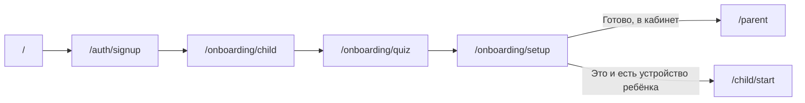
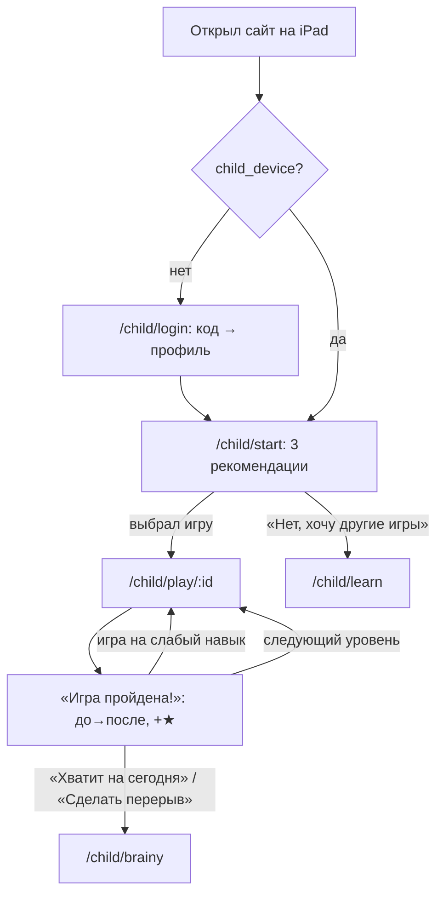
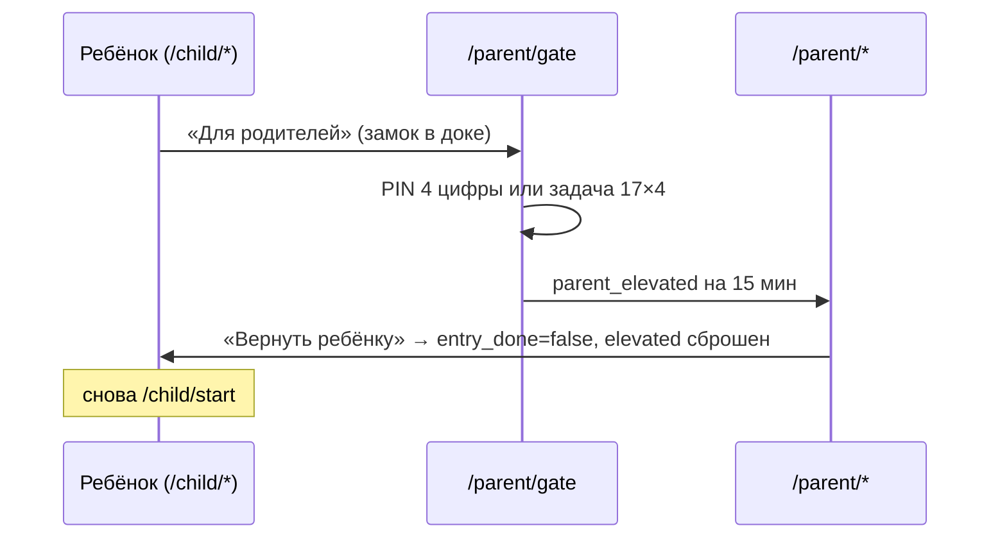

# Брейни MVP — роуты, роли и механика

Спецификация для разработки. Дополняет PRD: здесь только то, что нужно, чтобы собрать продукт — какие есть адреса, кто их видит, что на каждом экране, какие кнопки что делают, какие запросы уходят на сервер и какие события пишутся в аналитику.

Кликабельный прототип лежит рядом (папка `brainy-mvp/`). Каждая страница прототипа = один роут из этого документа. Вся логика прототипа в `assets/core.js`; каждая функция `Api.*` там подписана эндпоинтом, который она имитирует.

**Демо-доступы прототипа:** `mama@example.com` / `demo1234`, PIN родителя `1234`, код устройства ребёнка `482915`. На главной (`index.html#map`) есть быстрые входы, карта всех экранов и сброс данных.

---

## 1. Роли, устройства и сессии

Платит родитель, пользуется ребёнок. Данные общие: всё, что делает ребёнок, сразу видно родителю.

| Роль | Устройство | Как входит | Что видит |
|---|---|---|---|
| Родитель | свой телефон (основной сценарий) | email + пароль | кабинет `/parent/*` |
| Ребёнок | iPad или телефон ребёнка | один раз: 6-значный код из кабинета родителя → выбор профиля. Дальше без входа | только `/child/*` |
| Родитель на устройстве ребёнка | iPad ребёнка | PIN (или задача для взрослого) | кабинет на 15 минут, потом снова барьер |

### 1.1. Три вида токенов

| Токен | Выдаётся | Scope | Срок | Где хранится |
|---|---|---|---|---|
| `parent_session` | `POST /api/auth/login`, `POST /api/auth/signup` | `parent:*` для своей семьи | 30 дней, скользящий | httpOnly cookie |
| `child_device` | `POST /api/child-device/pair` по коду | `child:*` только для одного `child_id` | бессрочно, пока родитель не отключит устройство | httpOnly cookie + запись `Device` на сервере |
| `parent_elevated` | `POST /api/parent/gate` (PIN) **на устройстве с `child_device`** | `parent:*` | 15 минут | httpOnly cookie, отдельная от `child_device` |

Правила:
- С `child_device` недоступен ни один эндпоинт `/api/parent/*` — сервер отвечает `403 GATE_REQUIRED`, фронт ведёт на `/parent/gate`.
- `child_device` не даёт доступа к шерингу, внешним ссылкам, оплате (требование сторов к детским приложениям).
- Код подключения: 6 цифр, живёт 15 минут, одноразовый, новый код отзывает старый. 5 неверных попыток с одного IP → блок на 10 минут.
- PIN: 4 цифры, хранится хешем. 3 ошибки подряд → пауза 30 секунд (на сервере — 10 ошибок за час → блок и письмо родителю).
- Отключить устройство: `DELETE /api/parent/devices/:id` → `child_device` этого устройства перестаёт работать, на нём снова открывается `/child/login`.

### 1.2. Гарды роутов (порядок проверок)

```
guard(parent, page):
  нет аккаунта в семье                   → /auth/signup
  устройство в режиме ребёнка и нет parent_elevated → /parent/gate#<page>
  нет parent_session                     → /auth/login
  онбординг не завершён                  → /onboarding/<шаг>
  иначе                                  → показать page

guard(child, page):
  нет child_device                       → /child/login
  входной экран ещё не пройден в этой сессии и page ≠ start → /child/start
  иначе                                  → показать page

/ (корень):
  есть child_device                      → /child/start
  есть parent_session и онбординг готов  → /parent
  иначе                                  → лендинг выбора роли
```

**«Сессия ребёнка»** для входного экрана = с момента открытия приложения до 30 минут бездействия, либо до возврата из кабинета родителя. Флаг `entry_done` хранится в памяти вкладки (sessionStorage) + отметка на сервере. Каждая новая сессия ребёнка снова начинается с `/child/start` — это требование PRD «при каждом входе в режим ребёнка».

---

## 2. Карта роутов

| Роут | Кто | Гард | Файл прототипа | Назначение |
|---|---|---|---|---|
| `/` | все | редирект по сессии | `index.html` | выбор роли: «Я родитель» / «Это устройство ребёнка» |
| `/auth/signup` | гость | — | `auth/signup.html` | регистрация родителя, согласие на обработку данных ребёнка |
| `/auth/login` | гость | — | `auth/login.html` | вход родителя |
| `/auth/reset` | гость | — | *(нет в прототипе)* | сброс пароля по письму |
| `/onboarding/child` | родитель | parent_session | `onboarding/child.html` | имя и год рождения ребёнка → лига |
| `/onboarding/quiz` | родитель | parent_session | `onboarding/quiz.html` | habit-квиз, 5 вопросов → стартовый Брейни |
| `/onboarding/setup` | родитель | parent_session | `onboarding/setup.html` | PIN, код устройства, инструкция Экранного времени |
| `/child/login` | устройство | нет child_device | `child/login.html` | ввод кода, выбор профиля |
| `/child/start` | ребёнок | child | `child/start.html` | «Во что играем сейчас?» — обязательный экран входа |
| `/child/learn` | ребёнок | child + entry | `child/learn.html` | вкладка «Учимся» |
| `/child/play/:gameId?level=N` | ребёнок | child + entry | `child/play.html#odd-1` | экран развивающей игры и «Что дальше?» |
| `/child/leisure` | ребёнок | child + entry | `child/leisure.html` | вкладка «Отдых»: магазин игр, мультфильмы, научпоп |
| `/child/fun/:itemId` | ребёнок | child + entry + открыт | `child/fun.html#snake` | развлекательная игра с таймером |
| `/child/watch/:videoId` | ребёнок | child + entry (+ куплен для мультфильма) | `child/watch.html#ocean` | плеер: научпоп и мультфильмы |
| `/child/gifts` | ребёнок | child + entry | `child/gifts.html` | вкладка «Подарки»: цель недели, задания, магазин подарков |
| `/child/brainy` | ребёнок | child + entry | `child/brainy.html` | вкладка «Брейни»: стадии, аксессуары, статы, награды |
| `/parent/gate` | устройство ребёнка | child_device | `parent/gate.html#home` | родительский барьер (PIN / задача для взрослого) |
| `/parent` | родитель | parent | `parent/index.html` | «Аналитика» + «Требует внимания» + лента событий |
| `/parent/tasks` | родитель | parent | `parent/tasks.html` | «Задания»: форма, сегодня, рекомендации |
| `/parent/rewards` | родитель | parent | `parent/rewards.html` | «Подарки и цель»: цель недели, магазин, запросы |
| `/parent/settings` | родитель | parent | `parent/settings.html` | ребёнок, устройства, PIN, подписка, выход |

> В прототипе параметры передаются через `#` (`play.html#odd-2`), потому что хостинг прототипа не пропускает query-строки. В продукте — нормальные path/query-параметры, как в колонке «Роут».

### 2.1. Навигация

**Ребёнок** (iPad-first, работает и на телефоне): нижняя панель из 4 вкладок — Учимся · Отдых · Подарки · Брейни. Над «Учимся», «Отдыхом» и «Подарками» стоит док Брейни. На `/child/start`, `/child/play`, `/child/fun`, `/child/watch` нет ни дока, ни вкладок — только кнопка «×». На вкладке «Подарки» бейдж = число реальных заданий в статусе «Назначено».

**Родитель** (телефон-first): нижняя панель из 4 вкладок — Аналитика · Задания · Подарки и цель · Настройки. На ширине от 1000 px панель становится левым сайдбаром. Бейджи: «Задания» = задания в статусе «Ждёт подтверждения», «Подарки и цель» = невручённые подарки. В шапке: имя ребёнка с мини-Брейни и кнопка «Режим ребёнка» (на устройстве ребёнка — «Вернуть ребёнку»).

---

## 3. Основные потоки

### 3.1. Первый запуск родителя



Онбординг — линейный, шаг хранится в `Family.onboarding_step`. Закрыл вкладку посередине → при следующем входе гард вернёт на незаконченный шаг.

### 3.2. Сессия ребёнка



### 3.3. Ребёнок → кабинет → обратно (общий планшет)



### 3.4. Задание в реальной жизни

```mermaid
sequenceDiagram
  participant Par as Родитель /parent/tasks
  participant S as Сервер
  participant Kid as Ребёнок /child/gifts
  Par->>S: POST /api/parent/tasks (real, 2☀)
  S-->>Kid: realtime task.created → бейдж на «Подарках»
  Kid->>S: POST /api/child/tasks/:id/done
  S-->>Par: push «Амир сделал: Убраться в комнате» + бейдж
  Par->>S: POST /api/parent/tasks/:id/confirm
  S->>S: suns += 2, week_suns += 2, resp += 2
  S-->>Kid: realtime wallet.updated (+ goal.reached, если цель закрыта)
```

### 3.5. Подарок

`/child/gifts` «Купить за N ☀» → `POST /api/child/gifts/:id/buy` (суны списываются сразу, `week_suns` не трогается) → создаётся `GiftRequest(pending)` → push родителю → `/parent/rewards` «Вручено» → `delivered`.

---

## 4. Публичные роуты и онбординг

### `/` — выбор роли
- Две карточки: «Я родитель» (Создать аккаунт / Войти) и «Это устройство ребёнка» (Подключить устройство).
- Сначала редирект по сессии (см. 1.2), поэтому ребёнок на своём iPad этот экран не видит.
- В прототипе здесь же блок «Демо для команды» — в продукт не переносить.

### `/auth/signup`
- Поля: имя родителя, email, пароль (≥ 8), чекбокс согласия на обработку данных ребёнка (обязательный, со ссылкой на политику).
- `POST /api/auth/signup {name, email, password, consent:true}` → создаёт `Family`, `Parent`, выдаёт `parent_session`, `onboarding_step='child'`.
- Ошибки: email занят → «Аккаунт уже есть. Войти?».
- Событие: `signup_completed`.

### `/auth/login`
- Email + пароль, «Забыли пароль?» → `/auth/reset`.
- `POST /api/auth/login` → `parent_session`. Если онбординг не закончен — на его шаг, иначе `/parent`.

### `/onboarding/child`
- Имя ребёнка (до 20 символов), год рождения (текущий − 10 … текущий − 4). Под полем: «Возраст: 6 лет · лига „6 лет“».
- `PUT /api/parent/child {name, birth_year}` → сервер считает `age_league`.
- Подсказка о приватности: в рейтингах только имя и первая буква фамилии.

### `/onboarding/quiz`
- 5 вопросов по одному на экран, ответ по тапу сразу листает дальше, есть «Назад».
  1. Сколько часов в день в телефоне/планшете (больше 4 / 2–4 / 1–2 / меньше часа)
  2. Что чаще смотрит (шортсы / мемный контент / YouTube Kids / мультфильмы целиком)
  3. Досматривает ли 10-минутный мультфильм
  4. Как реагирует, когда забирают телефон
  5. Читает ли сам
- Каждый ответ = 0…3 балла (0 — хуже). `POST /api/parent/quiz {answers}` → сервер считает `BrainyState.start_snapshot` и стартовые `SkillScore`. Формула-заглушка в прототипе (`quiz.html`), итоговую задаёт методист. Ограничение: стартовые статы не выше 40, чтобы Брейни был «сонным» или «проснувшимся».
- Финал: стартовый Брейни + история про Скролл-монстра + «Эти ответы — точка „было“ в аналитике».
- Событие: `quiz_completed`.

### `/onboarding/setup`
- **PIN:** 4 цифры дважды → `PUT /api/parent/pin`.
- **Устройство ребёнка:** переключатель iPad/iPhone ↔ Android, пошаговые инструкции (Экранное время / Family Link) с видео на каждый шаг; код подключения крупно, «действует 15 минут» (`POST /api/parent/devices/pair-code`).
- «Проверить белый список» — страница на устройстве ребёнка пытается открыть внешний домен; если не открылся, белый список включён. Событие `whitelist_check {result}`.
- Кнопки: «Готово, в кабинет» → `/parent`; «Это и есть устройство ребёнка» → текущее устройство получает `child_device` → `/child/start`.

### `/child/login`
- Если `child_device` уже есть — сразу `/child/start`.
- Шаг 1: Брейни «Попроси маму или папу ввести код», 6 точек, цифровая клавиатура (не системная — крупные кнопки). Неверный код → «Код не подошёл», точки сбрасываются.
- Шаг 2: «Кто играет?» — карточки профилей с Брейни каждого ребёнка (в MVP один ребёнок, но экран оставить — модель данных под нескольких детей).
- `POST /api/child-device/pair {code}` → `child_device` + `Device{name, user_agent}`. Событие `child_device_paired`.

### `/parent/gate` — родительский барьер
- Открывается при любом заходе на `/parent/*` с устройства, где есть `child_device`. Хеш/параметр = куда вернуть после входа.
- PIN на собственной клавиатуре. 3 ошибки → пауза 30 сек.
- «Забыли PIN? Решить задачу для взрослого»: пример двузначное × однозначное (17 × 4). Решил → вход + подсказка сменить PIN.
- «Вернуться к Брейни» → `/child/learn` (вход через барьер не сбрасывает `entry_done`, если ребёнок не дошёл до кабинета).
- `POST /api/parent/gate {pin}` → `parent_elevated` на 15 минут. Событие `parent_gate_passed {method: pin|task}`.

---

## 5. Роуты ребёнка

Общие правила для всех экранов ребёнка:
- Никаких рейтингов, сравнений с другими детьми и внешних ссылок.
- Всё крупное, тап-цели от 44 px, тексты короткие (ребёнку 4–10 лет, многие не читают — в продукте реплики Брейни озвучиваются).
- Баланс и Брейни обновляются без перезагрузки (realtime, см. раздел 10).

### Док Брейни (на `/child/learn`, `/child/leisure`, `/child/gifts`)
| Элемент | Поведение |
|---|---|
| Брейни ~120 px с надетыми аксессуарами | тап → `/child/brainy` |
| Чип стадии, шкала самочувствия, «До стадии „Гений“ осталось 11 очк.» | только отображение |
| Кошелёк: ★ звёзды, ☀ солнышки | только отображение |
| «Цель недели: 6 / 10 ☀» с полоской | тап → `/child/gifts` |
| «🔒 Для родителей» | → `/parent/gate#home` |

### `/child/start` — «Во что играем сейчас?»
- **Показывается** при каждой новой сессии ребёнка. Нет «×», нет свайпа назад, нет вкладок. Выйти можно только выбором.
- Брейни + реплика «Мне нужно подкачать „внимание“. Поможешь?» (навык с наибольшим отставанием).
- 3 большие карточки. Первая с рамкой и пометкой «Важнее всего сейчас». На каждой: «Внимание 41 при среднем 52», название, «★ до 14», «Играть».
- Внизу мелкая ссылка «Нет, хочу посмотреть другие игры» → `/child/learn`.
- **Алгоритм** (`GET /api/child/recommendations`): по 6 умениям `lag = value − age_avg`, сортировка по возрастанию, 3 первых навыка, для каждого — игра этого навыка, в которую играл реже всего за 7 дней. Навыки без развивающей игры (моторика) пропускаются.
- `POST /api/child/entry {choice:'recommendation', game_id, rank}` или `{choice:'skip'}` → `entry_done=true`.
- События: `entry_screen_shown`, `entry_recommendation_chosen {game_id, rank}`, `entry_skipped`. Из них считаются KPI «Выбирает рекомендации Брейни» и радар «Делай сложное».

### `/child/learn` — «Учимся»
- «Брейни советует»: те же 3 рекомендации с причиной.
- «Все развивающие игры»: сетка из 8 игр — название, чип навыка, «★ до N». Недоделанные игры в MVP показывать с пометкой «Скоро» и не пускать.
- Развлечения на этой вкладке не показываются.
- `GET /api/child/games?kind=dev`.

### `/child/play/:gameId?level=N` — игра
- Шапка: «×», название · уровень, чипы навыков (основной, доп.), полоски раундов, «★ +N» за сессию.
- Раунд: верно с первой попытки → +3 ★, зелёная рамка, «Верно! +3 ★ · Дальше». Неверно → карточка трясётся, «Почти! Присмотрись и попробуй ещё раз». Верно после ошибки → «Звезда за исправление! +4 ★».
- «×» посреди игры → диалог «Выйти? Звёзды за эту игру начисляются, когда она пройдена до конца» (Доиграть / Выйти). Раунды не сохраняются.
- **Финал** (без выхода в меню):
  - «Игра пройдена!», Брейни до → после, «★ +13 звёзд», чип прироста («Глаза +3»).
  - 2 карточки «Что дальше?»: игра на самый слабый навык (из рекомендаций, не текущая) и «эта же игра · уровень N+1».
  - Ссылка «Хватит на сегодня» → `/child/brainy` с тостом «Брейни отдыхает и говорит спасибо!».
  - После 3 игр подряд за день: разовый бонус +5 ★, плашка «Брейни советует сделать перерыв», главная кнопка становится «Сделать перерыв». Счётчик подряд сбрасывается по «Хватит» и в полночь.
  - Если стадия выросла: модальное окно «Новая стадия! Брейни теперь „Умник“» + push родителю.
- API: `POST /api/child/games/:id/sessions` (старт) → `POST /api/child/game-sessions/:sid/rounds` (каждый ответ) → `POST /api/child/game-sessions/:sid/finish`. Ответ `finish`: `{stars, bonus, stats_before, stats_after, stage_up, in_row, next:[…]}`. **Звёзды считает сервер** по журналу раундов, клиент только показывает.
- Побочно при `finish`: самочувствие +8; задания родителя «в приложении» на сегодня закрываются автоматически.
- События: `game_started`, `round_answered {correct, after_mistake}`, `game_finished`, `next_step_chosen {same_game_next_level | weak_skill_game | stop}`, `break_suggested`, `stage_up {from,to}`.

### `/child/leisure` — «Отдых»
- **Магазин игр:** 5 игр, у каждой навык (пространственное мышление, реакция, ритм, меткость, ловкость рук). Состояния карточки:
  - закрыта: «10 мин · 30★» и «Навсегда · 450–600★»;
  - открыта на время: «Осталось 6 мин» + «Играть»;
  - навсегда: «Открыта навсегда» + «Играть».
  Не хватает звёзд → тост «Не хватает N звёзд. Загляни в „Учимся“».
- **Мультфильмы и сказки:** «Открыть · 50★» → после покупки «Смотреть». Покупка навсегда.
- **Научпоп:** бесплатно, 20–26 мин. Состояния: «Смотреть» / полоска + «Продолжить с 9 мин» / «Досмотрено · +15★ получено».
- API: `GET /api/child/leisure`, `POST /api/child/shop/:id/unlock {type: timer|forever}`, `POST /api/child/videos/:id/unlock`. Событие `shop_unlock {item, type, cost}`.

### `/child/fun/:itemId` — развлекательная игра
- Доступ только если игра открыта, иначе назад в «Отдых» с тостом.
- В шапке «×», название, навык и остаток «Осталось 9:58» (или «Навсегда»).
- **Таймер списывается только пока игра открыта и вкладка активна** — heartbeat раз в 15 сек `POST /api/child/shop/:id/heartbeat {seconds}`. Сервер — источник правды по остатку.
- Остаток 0 → игра закрывается, экран «Время вышло. Заработай ещё звёзд» + «В „Учимся“» / «В „Отдых“». Повторная покупка таймера добавляет 10 минут к остатку.
- Игра грузится с нашего домена (iframe того же origin), иначе её заблокирует белый список.
- Развлекательные игры качают руки/ноги Брейни (заглушка: +1 к стату за сессию от минуты, формулу задаёт методист).

### `/child/watch/:videoId` — плеер
- Единственное управление — «Пауза / Продолжить». Прогресс-бар только показывает позицию, по нему нельзя тапнуть. Перемотки, выбора серии и автоплея нет.
- **Научпоп:** позиция сохраняется раз в 10 сек и при закрытии (`PUT /api/child/videos/:id/progress {position}`). «Закрыть и досмотреть позже» → «Отдых», тост «Продолжишь с 9 минуты». В конце вопрос из 3 вариантов: верно → +15 ★ и глаза +2 (только первый раз), неверно → вариант гаснет, можно ещё. `POST /api/child/videos/:id/answer {option}`.
- **Мультфильм:** только после покупки, всегда с начала, в конце «Серия закончилась» + «В „Учимся“» / «В „Отдых“». Никакой ленты «смотреть дальше».
- Видео отдаются с нашего домена (HLS), без YouTube. Лимит длительности по возрасту — открытый вопрос PRD.
- События: `video_started`, `video_paused`, `video_resumed`, `video_closed {position}`, `video_completed`, `video_question_answered {correct}`.

### `/child/gifts` — «Подарки»
- Заголовок «Подарки от мамы» (берётся из профиля родителя).
- **Цель недели:** «Собери 10 солнышек и получи: Поход в кино», полоска по `week_suns`, «до воскресенья». Выполнена → «Цель выполнена! Подарок ждёт».
- **Задания на сегодня:** реальные — «Готово!» → статус «Ждёт подтверждения»; «в приложении» — «Засчитается само». Пусто → «На сегодня заданий нет».
- **Магазин подарков:** кнопка с ценой в ☀, неактивна, если не хватает. Приз за цель помечен. Покупка → тост «Ура! Родитель получит запрос», подарок в блоке «Ждут вручения».
- **Обмен** «1 ☀ на 10 ★», только в эту сторону.
- API: `GET /api/child/gifts`, `POST /api/child/tasks/:id/done`, `POST /api/child/gifts/:id/buy`, `POST /api/child/wallet/exchange {suns:1}`.
- События: `task_marked_done_by_child`, `gift_bought`, `suns_exchanged`.

### `/child/brainy` — «Брейни»
- Большой Брейни, реплика с советом на самый слабый из «учебных» статов (мозг/глаза/рот) и кнопка, которая сразу запускает эту игру.
- Стадия, шкала из 5 стадий, остаток до следующей, самочувствие.
- **Наряди Брейни:** 6 аксессуаров с превью. «120 ★» (купить и сразу надеть) / «Надеть» / «Снять». Один предмет на слот (голова, лицо, шея).
- **Что качает Брейни:** 5 частей тела со значением и подписью навыков.
- **Заслуженные награды:** рюкзак капитана, значок исследователя, свой сад, плащ героя. Незаработанные — пунктиром с условием («откроется на 50»).
- Демо-блок из старого прототипа («После квиза / Сейчас / Только развлечения», ползунок по неделям) в продукт не переносим.
- API: `GET /api/child/brainy`, `POST /api/child/accessories/:id/buy`, `PUT /api/child/accessories/:id/equip {equipped}`.
- События: `accessory_bought`, `accessory_equipped`.

---

## 6. Роуты родителя

### `/parent` — «Аналитика»
Сверху вниз:
1. **Требует внимания** (только если есть что делать): «Подтвердить 2 задания» → `/parent/tasks`, «Вручить 1 подарок» → `/parent/rewards`, «Назначить задания на сегодня» (если сегодня пусто). Это главный повод заходить каждый день.
2. **Брейни-герой:** Брейни с аксессуарами, «Амир, 6 лет», стадия, «Сонный → Умник. До „Гений“ осталось 11 очк.», шкала стадий, самочувствие, маленький Брейни «после квиза».
3. **4 метрики:** средняя сессия концентрации; серия дней подряд; солнышки за неделю против цели; доля входов с выбором рекомендации («71% · 20 из 28 входов»).
4. **Инсайт:** навык с наибольшим ростом за месяц и самый отстающий от среднего по возрасту + ссылка на `/parent/tasks#recs`.
5. **Радар умений** (6 осей): сейчас / месяц назад / среднее по возрасту среди пользователей (пунктир).
6. **Радар характера** (5 осей), подпись «Индикатор по игровому поведению, а не тест».
7. **Время за неделю:** столбцы по дням (развивающие / научпоп / развлечения) + строка «Учёба к развлечениям: 2,8 : 1 (цель — не ниже 1,5 : 1)».
8. **Делай сложное:** доля рекомендованных выборов по 8 неделям + «Доведено до конца: 23 из 26».
9. **Рейтинг:** лига по возрасту, сезон = месяц, переключатели «Район / Город / Страна» и «По росту / Абсолютный», строка ребёнка подсвечена, итог «3-е место по росту из 312 · топ-1%». Только имя + первая буква фамилии. Район показывается только при > 50 детях.
10. **Итоги месяца для сторис:** карточка с Брейни, стадией и 2–3 достижениями, реферальный код. «Поделиться» → Web Share API с PNG карточки (на телефоне родителя).
11. **Лента событий:** последние 8 событий ребёнка с «2 ч назад».

- Первая неделя (`fresh`): плашка «Графики заполнятся по мере игр, пока показан пример».
- API: `GET /api/parent/dashboard` (агрегаты одним запросом), `GET /api/parent/leaderboard?scope=rayon|city|country&mode=growth|abs`, `POST /api/parent/share-card` → PNG + код. События `share_card_opened`, `share_card_shared {referral_code}`.

### `/parent/tasks` — «Задания»
- Шапка: «Заданий на сегодня: 4 из 5» + полоска.
- **Форма:** что сделать; где (в реальной жизни → ☀ / в приложении → ★; подпись поля награды и дефолт меняются: 2 ☀ / 15 ★); какой навык качает (8 вариантов); награда. «Назначить».
- **Шаблоны для возраста:** Убраться 2 ☀, Улица 1 ☀, Книжка 3 ☀, Домашка сам 2 ☀, Пятёрка 3 ☀ — тап заполняет форму. Совет про награду за усилие.
- **Сегодня:** список со статусами. «Назначено» → «Отменить»; «Ждёт подтверждения» → «Подтвердить»; «Выполнено» — приглушено. Чип «Обещание Амира: 3 задания» (задаётся в настройках со слов ребёнка).
- **Рекомендации** (якорь `#recs`): навыки, которые проседают — значение против среднего (полоска с отметкой), часть Брейни, причина из поведения, 1–2 конкретных задания с наградой и длительностью. «Назначить» → в «Сегодня», рекомендация исчезает.
- **Лимит 5 заданий в день** (назначенные на сегодня в любом статусе). Шестое → тост «Лимит 5 заданий в день, чтобы платформа не превращалась в контроль». Проверка на сервере, `409 TASK_LIMIT`.
- **Подтверждение** реального задания: +☀ на баланс, +☀ в `week_suns`, `resp` +2. Цель закрылась → тост и push «Цель недели выполнена! Подарок: Поход в кино».
- API: `GET /api/parent/tasks?date=today`, `POST /api/parent/tasks {title, kind, skill, reward, source}`, `POST /api/parent/tasks/:id/confirm`, `DELETE /api/parent/tasks/:id`, `GET /api/parent/recommendations`.
- События: `task_created {source: manual|template|recommendation}`, `task_confirmed`, `weekly_goal_reached`.

### `/parent/rewards` — «Подарки и цель»
- Плашка правил: 1 ☀ = 10 ★, обмен только в одну сторону, подарки только за солнышки.
- **Цель недели:** число ☀ до воскресенья (1–50), приз из списка подарков, прогресс. `PUT /api/parent/goal`. Новая цель действует с текущей недели, прогресс не обнуляет.
- **Магазин подарков:** список с ценой, «Убрать»; форма «Новый подарок» (название, цена 1–100 ☀). Убрали приз недели → призом становится первый подарок списка. Стартовый набор: кино 10, мороженое 3, наклейки 2, мультик на вечер 4, парк аттракционов 15.
- **Запросы от ребёнка:** что купил и когда, «Вручено» → чип «Вручено».
- API: `GET /api/parent/rewards`, `POST /api/parent/gifts`, `DELETE /api/parent/gifts/:id` (мягкое удаление: `active=false`, старые запросы не ломаются), `POST /api/parent/gift-requests/:id/deliver`. Событие `gift_delivered`.

### `/parent/settings` — «Настройки»
- **Ребёнок:** имя, год рождения, «обещание ребёнка» (1–5 заданий в день).
- **Устройства ребёнка:** код подключения + «Новый код»; список устройств с датой подключения и «Отключить».
- **Безопасность:** смена PIN.
- **Подписка и аккаунт:** тариф и дата продления, email, настройки push, «Выгрузить / удалить данные ребёнка», «Выйти из аккаунта».
- Оплата — только здесь, на телефоне родителя; на устройстве ребёнка раздел подписки скрыт.

---

## 7. Механика и формулы

Все константы — в конфиге сервера (`RULES` в `core.js`):

| Константа | Значение | Где |
|---|---|---|
| Раунд с первой попытки | +3 ★ | игра |
| Раунд после ошибки | +4 ★ («звезда за исправление») | игра |
| Бонус за 3 игры подряд | +5 ★, раз в день | финал игры |
| Научпоп досмотрен + верный ответ | +15 ★, глаза +2, раз на видео | плеер |
| Обмен | 1 ☀ → 10 ★, только так | подарки |
| Самочувствие за игру | +8 п.п., максимум 100 | финал игры |
| Самочувствие без занятий | −5 п.п. в день, нижний предел 30 | ночной крон |
| Подтверждённое реальное задание | +☀, +week_suns, resp +2 | родитель |
| Лимит заданий | 5 в день | родитель |
| Таймер развлекательной игры | 10 минут игрового времени | отдых |
| parent_elevated | 15 минут | барьер |

**Стадии** по среднему пяти статов (мозг, глаза, рот, руки, ноги): Сонный 0 · Проснувшийся 25 · Бодрый 40 · Умник 55 · Гений 70. Переход — событие `stage_up`, модальное окно у ребёнка и push родителю. Обратного перехода нет: если среднее упало ниже порога, стадия держится (Брейни не «болеет»), просто растёт «До стадии…».

**Как игра меняет статы.** У игры веса навыков (основной ≈ 70%, доп. ≈ 30%). Сессия прибавляет к `SkillScore` значение от уровня и точности, навыки сводятся в части тела (логика, память → мозг; внимание → глаза; речь, чтение → рот; моторика → руки; реакция → ноги). Заглушки прототипа: «Продолжи узор» мозг +2, «Найди лишний» глаза +3, научпоп глаза +2, задание resp +2. Точную формулу задаёт методист.

**Сброс дня (полночь по часовому поясу семьи):** счётчик игр подряд, флаг бонуса, вчерашние выполненные задания уходят из «Сегодня», невыполненные — в историю со статусом `expired`.
**Сброс недели (понедельник 00:00):** `week_suns = 0`, цель и приз сохраняются.

---

## 8. Состояния

```
Task:          todo ──(ребёнок «Готово!», только real)──▶ check ──(родитель «Подтвердить»)──▶ done
               todo ──(kind=app, финиш любой игры)──▶ done
               todo ──(родитель «Отменить»)──▶ deleted
               todo|check ──(конец дня)──▶ expired

GiftRequest:   pending ──(«Вручено»)──▶ delivered

ShopUnlock:    none ──(10 мин · 30★)──▶ timer{left_sec} ──(left_sec=0)──▶ none
               none|timer ──(навсегда)──▶ forever

VideoProgress: new ──▶ in_progress{position} ──(конец)──▶ completed ──(верный ответ)──▶ answered (звёзды начислены)

ChildSession:  no_device ──(код)──▶ entry_pending ──(выбор на /child/start)──▶ active
               active ──(30 мин бездействия | возврат из кабинета)──▶ entry_pending
```

---

## 9. API

Все ответы JSON, ошибки `{code, message}`. `child:*` эндпоинты сами берут `child_id` из токена — в URL его нет.

**Auth / устройства**
| Метод | Путь | Тело / ответ |
|---|---|---|
| POST | `/api/auth/signup` | `{name, email, password, consent}` |
| POST | `/api/auth/login` | `{email, password}` |
| POST | `/api/auth/logout` | — |
| POST | `/api/auth/reset` | `{email}` |
| POST | `/api/child-device/pair` | `{code}` → `{child:{id,name}}` |
| POST | `/api/parent/gate` | `{pin}` → elevated cookie |
| GET | `/api/me` | роль, семья, ребёнок, шаг онбординга |

**Ребёнок**
| Метод | Путь | Назначение |
|---|---|---|
| GET | `/api/child/home` | Брейни, кошелёк, цель, бейджи (для дока) |
| GET | `/api/child/recommendations` | 3 игры для входного экрана |
| POST | `/api/child/entry` | `{choice, game_id?, rank?}` |
| GET | `/api/child/games?kind=dev` | каталог развивающих |
| POST | `/api/child/games/:id/sessions` | `{level}` → `{session_id, rounds}` |
| POST | `/api/child/game-sessions/:sid/rounds` | `{round, option, correct}` |
| POST | `/api/child/game-sessions/:sid/finish` | → `{stars, bonus, stats_before, stats_after, stage_up, in_row, next}` |
| POST | `/api/child/session/stop` | «Хватит на сегодня» |
| GET | `/api/child/leisure` | магазин, мультфильмы, научпоп с прогрессом |
| POST | `/api/child/shop/:id/unlock` | `{type: timer|forever}` |
| POST | `/api/child/shop/:id/heartbeat` | `{seconds}` → `{left_sec}` |
| POST | `/api/child/videos/:id/unlock` | покупка мультфильма |
| PUT | `/api/child/videos/:id/progress` | `{position}` |
| POST | `/api/child/videos/:id/answer` | `{option}` → `{correct, stars}` |
| GET | `/api/child/gifts` | цель, задания на сегодня, подарки, запросы |
| POST | `/api/child/tasks/:id/done` | ребёнок отметил |
| POST | `/api/child/gifts/:id/buy` | → `GiftRequest` |
| POST | `/api/child/wallet/exchange` | `{suns:1}` |
| GET | `/api/child/brainy` | статы, стадии, аксессуары, награды |
| POST | `/api/child/accessories/:id/buy` | покупка + надеть |
| PUT | `/api/child/accessories/:id/equip` | `{equipped}` |

**Родитель**
| Метод | Путь | Назначение |
|---|---|---|
| PUT | `/api/parent/child` | имя, год рождения, обещание |
| POST | `/api/parent/quiz` | ответы квиза |
| PUT | `/api/parent/pin` | `{pin}` |
| POST | `/api/parent/devices/pair-code` | новый код |
| GET / DELETE | `/api/parent/devices[/:id]` | список / отключить |
| GET | `/api/parent/dashboard` | всё для «Аналитики» + «Требует внимания» + лента |
| GET | `/api/parent/leaderboard` | `?scope&mode` |
| POST | `/api/parent/share-card` | PNG + реферальный код |
| GET | `/api/parent/tasks` | `?date=today` |
| POST | `/api/parent/tasks` | `{title, kind, skill, reward, source}`; `409 TASK_LIMIT` |
| POST | `/api/parent/tasks/:id/confirm` | → `{wallet, goal_reached}` |
| DELETE | `/api/parent/tasks/:id` | только `todo` |
| GET | `/api/parent/recommendations` | задания в реальной жизни по проседающим навыкам |
| GET | `/api/parent/rewards` | цель, подарки, запросы |
| PUT | `/api/parent/goal` | `{target_suns, prize_gift_id}` |
| POST / DELETE | `/api/parent/gifts[/:id]` | добавить / убрать |
| POST | `/api/parent/gift-requests/:id/deliver` | вручено |

---

## 10. Синхронизация в реальном времени

Ребёнок и родитель на разных устройствах, PRD требует «видно без перезагрузки». Один канал SSE (`GET /api/stream`) на семью, фронт обновляет нужные блоки.

| Событие канала | Кто слушает | Что обновить |
|---|---|---|
| `wallet.updated` | ребёнок, родитель | док, кошелёк, кнопки магазинов |
| `brainy.updated {stats, stage}` | ребёнок, родитель | все Брейни на экране |
| `task.created / task.updated` | ребёнок, родитель | список заданий, бейджи вкладок |
| `gift_request.created / delivered` | родитель, ребёнок | «Запросы», «Ждут вручения», бейдж |
| `goal.updated / goal.reached` | ребёнок, родитель | карточка цели, тост |
| `device.revoked` | устройство ребёнка | выйти на `/child/login` |

**Push родителю** (Web Push в PWA): ребёнок отметил задание; ребёнок купил подарок; новая стадия Брейни; цель недели выполнена. Не чаще 1 push на тип в 10 минут (группировка).

---

## 11. Где возникают события аналитики

| Роут | События |
|---|---|
| `/auth/signup`, `/onboarding/*` | `signup_completed`, `quiz_completed`, `whitelist_check`, `child_device_paired` |
| `/parent/gate` | `parent_gate_passed {method}`, `parent_gate_failed` |
| `/child/start` | `entry_screen_shown`, `entry_recommendation_chosen`, `entry_skipped` |
| `/child/play` | `game_started`, `round_answered`, `game_finished`, `next_step_chosen`, `break_suggested`, `stage_up` |
| `/child/leisure`, `/child/fun` | `shop_unlock`, `fun_started`, `fun_finished {seconds}` |
| `/child/watch` | `video_started`, `video_paused`, `video_resumed`, `video_closed`, `video_completed`, `video_question_answered` |
| `/child/gifts` | `task_marked_done_by_child`, `gift_bought`, `suns_exchanged` |
| `/child/brainy` | `accessory_bought`, `accessory_equipped` |
| `/parent/tasks` | `task_created {source}`, `task_confirmed`, `weekly_goal_reached` |
| `/parent/rewards` | `gift_delivered` |
| `/parent` | `share_card_opened`, `share_card_shared` |

Все события с `family_id`, `child_id`, `device_id`, `role`, `ts`. KPI MVP считаются из них: соотношение учёба/развлечения ≥ 1,5 : 1 (`game_finished` + `video_completed` против `fun_finished`), заходы родителя ≥ 4 дней в неделю (сессии `/parent`).

---

## 12. Решения, которые прототип принял сверх PRD (подтвердить)

1. **Вход ребёнка — код + выбор профиля**, без пароля. Устройство помнится навсегда, пока родитель не отключит.
2. **Родительский барьер даёт 15 минут** кабинета на устройстве ребёнка, «Вернуть ребёнку» сразу закрывает доступ и снова показывает входной экран.
3. **Таймер развлекательной игры тратится только во время игры**, а не по часам. Повторная покупка добавляет 10 минут.
4. **Выход из игры посередине** — звёзды за пройденные раунды не начисляются (иначе можно фармить лёгкие раунды).
5. **Мультфильм покупается навсегда** и всегда начинается с начала; научпоп помнит позицию.
6. **«Требует внимания» и лента событий** первым блоком аналитики — повод зайти каждый день.
7. **Самочувствие −5 п.п. в день без игр, не ниже 30.**
8. **Стадия не откатывается** при падении статов.
9. **Реплика Брейни на вкладке «Брейни»** советует игру только по «учебным» статам (мозг, глаза, рот), чтобы не уводить в развлечения.
10. **Задание можно отменить** только пока оно «Назначено».

---

## 13. Приёмка MVP → где проверить в прототипе

| Критерий PRD | Роут | Как проверить |
|---|---|---|
| Входной экран при каждом входе, без «×», 3 игры по отставанию, выбор в аналитику | `/child/start` | открыть `/child/learn` напрямую в новой сессии — редирект на `/child/start` |
| До → после, два следующих шага, «Хватит», перерыв и бонус после 3 игр | `/child/play` | пройти 3 игры подряд |
| Статы и стадия пересчитываются после каждой игры и видны у обоих | `/child/play` → `/parent` | сравнить Брейни в доке и в кабинете |
| Аксессуары: купить, надеть, снять, один на слот, видны везде | `/child/brainy` | надеть кепку → док, вход, кабинет, карточка сторис |
| Научпоп: только пауза, позиция сохраняется, звёзды после верного ответа | `/child/watch` | закрыть на середине, вернуться |
| Задание: «Готово» → «Подтвердить» → ☀, цель недели, resp | `/child/gifts` → `/parent/tasks` | |
| Подарки только за ☀, обмен только ☀ → ★ 1 : 10 | `/child/gifts` | |
| Лимит 5 заданий в день | `/parent/tasks` | назначить шестое |
| Рейтинг не виден ребёнку, фамилия скрыта | `/parent` | на `/child/*` рейтинга нет |
| Все ресурсы с нашего домена, работает с белым списком | все | шрифты в продукте — self-hosted (в прототипе Google Fonts) |
| Ребёнок не попадает в кабинет без PIN | `/parent/*` с устройства ребёнка | редирект на `/parent/gate` |

---

## 14. Структура прототипа

```
brainy-mvp/
  index.html              /              выбор роли + демо-карта экранов
  auth/                   /auth/*        signup, login
  onboarding/             /onboarding/*  child, quiz, setup
  child/                  /child/*       login, start, learn, play, leisure, fun, watch, gifts, brainy
  parent/                 /parent/*      gate, index, tasks, rewards, settings
  assets/app.css          токены и компоненты (светлая и тёмная тема)
  assets/core.js          мок-API (localStorage), сессии и гарды, каталоги, экономика, рендер Брейни
  assets/shell.js         оболочки: док + вкладки ребёнка, шапка + вкладки/сайдбар родителя
  ROUTES.md               этот документ
```

Данные прототипа живут в `localStorage` браузера (ключи `brainy.db.v1`, `brainy.auth.v1`), поэтому «ребёнок» и «родитель» в одном браузере видят одно состояние — так удобно показывать связку. В продукте это сервер + realtime из раздела 10.
