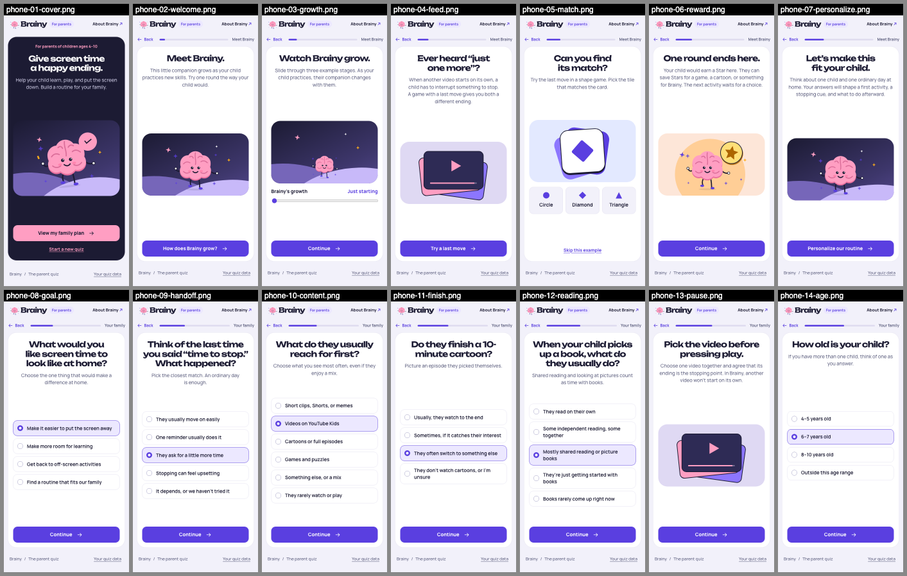
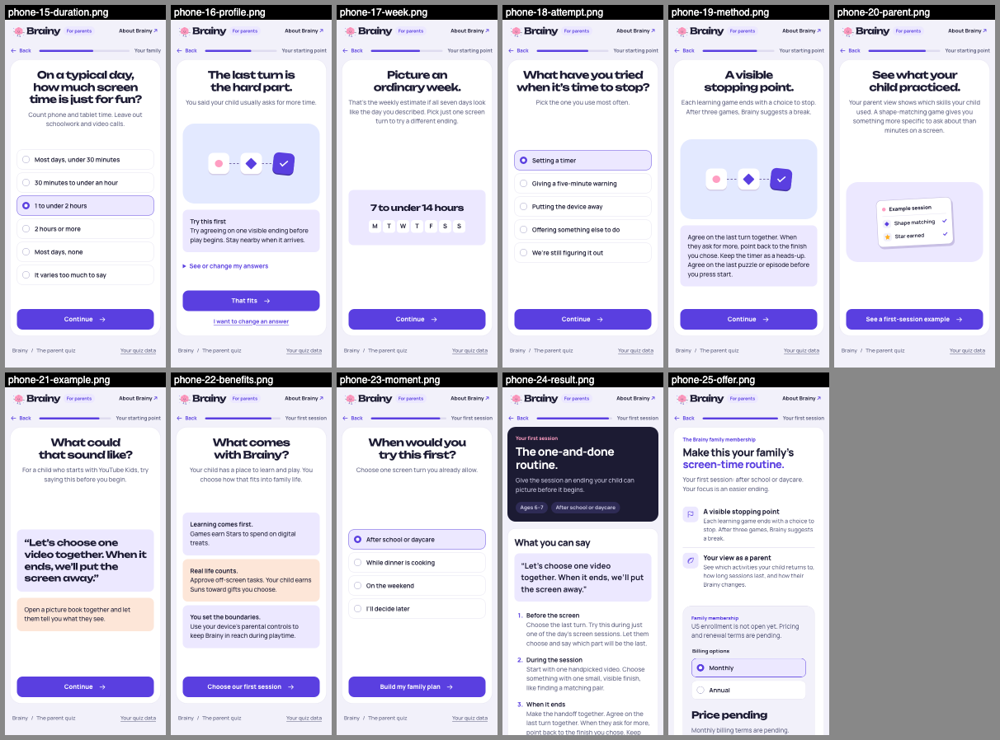
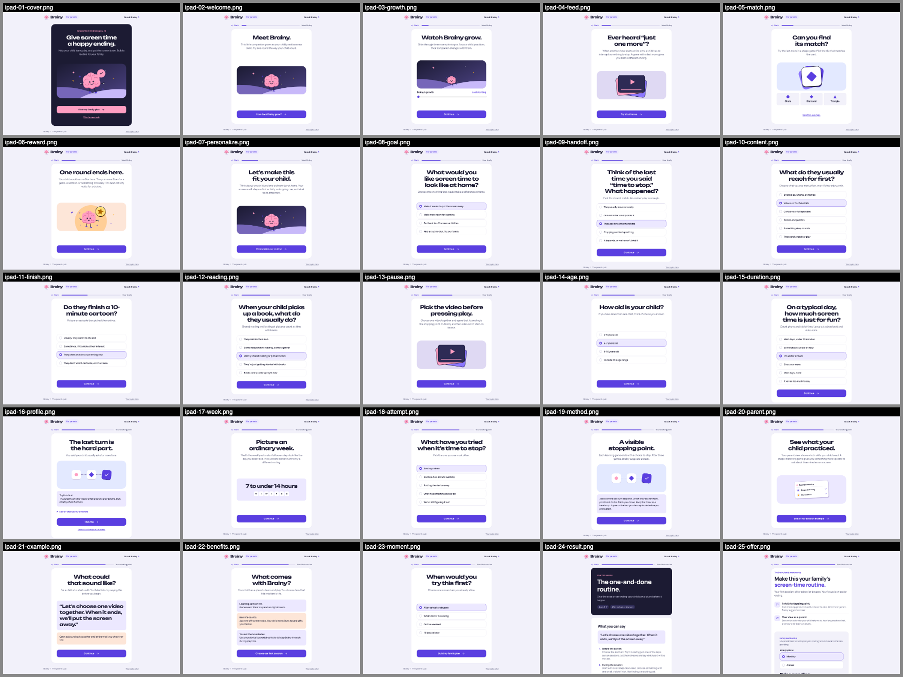

# Brainy Funnel Export: analysis

The source for the redesign: a 25-screen, US-English onboarding quiz for parents plus the lavender visual system ("AppLavender"). The implementation plan lives in [plans/redesign.md](../plans/redesign.md). **For visuals, [design.md](design.md) (the full Claude Design app) takes precedence**; the funnel's static mascot is replaced by the Brain component. The decisions are D-34, D-35 and D-36 in [decisions.md](../dev/decisions.md).

- **Source:** [ideas/Brainy-Funnel-Export.zip](../ideas/Brainy-Funnel-Export.zip). Unzip it **outside the repo** (temp dir) and serve `website/` with `python3 -m http.server`. No build is needed.
  - `website/engine.mjs`: questions, routing, profile and plan logic.
  - `website/funnel.mjs`: screens and events.
  - `website/story-art.mjs` + `story-art.css`: CSS art scenes.
  - `website/design-tokens.css`: tokens.
  - `website/assets/`: mascot SVG, Manrope woff2, Unbounded TTF, OFL licences.
  - `Open Brainy.html`: a single-file offline build.
- **Safety check, done:** no external URLs, CDNs, trackers or keyframe animations; fonts are OFL.
- **Screenshots** below were captured with the answers ending · 6–7 · 1–2 h · YouTube Kids · switches · bargains · shared reading · timer · after school.

## Screens

| # | Chapter | Screen | Content |
|---|---|---|---|
| 1 | — | cover | Dark hero card, "Give screen time a happy ending", pink CTA. The headline changes with `?angle=ending\|learning\|offline` |
| 2–7 | Meet Brainy | welcome, growth, feed, match, reward, personalize | Mascot intro; 3-stage growth slider; "just one more" (feed vs a game with a last move); shape match demo (answer: Diamond); "One round ends here" + Star; personalize |
| 8–15 | Your family | goal, handoff, content, finish, reading, pause, age, duration | 7 questions plus one insight screen (`pauseFor`). Age is asked at #14; "outside 4–10" is a dead end |
| 16–21 | Your starting point | profile, week, attempt, method, parent, example | Pattern (`profileFor`) with "See or change my answers"; weekly estimate (`weekFor`); what the parent tried; feature for their goal; example parent view; a phrase to say |
| 22–25 | Your first session | benefits, moment, result, offer | Benefits list (Stars, Suns, parental controls); when to start; **family plan**; membership offer ("pricing pending" until configured) |

Key screens: [cover](funnel/phone-01-cover.png), [growth](funnel/phone-03-growth.png), [match](funnel/phone-05-match.png), [reward](funnel/phone-06-reward.png), [question](funnel/phone-10-content.png), [profile](funnel/phone-16-profile.png), [parent view](funnel/phone-20-parent.png), [benefits](funnel/phone-22-benefits.png), [result (phone)](funnel/phone-24-result.png), [result (iPad)](funnel/ipad-24-result.png), [offer](funnel/phone-25-offer.png).

## Logic (`engine.mjs`)

- **Questions** (single choice): goal, age (4–5 / 6–7 / 8–10 / outside), duration, content, finish, handoff, reading, then attempt and moment.
- **Navigation:**
  - `ROUTE` lists the 25 screen IDs.
  - `reachable()` stops deep links from skipping unanswered questions.
  - `entryFor()` picks where to resume.
  - `restore()` migrates saved state from v2/v3 to v4.
- **Storage:** `localStorage` key `brainy.us-parent-quiz.v2`. `?tour=1` switches to `sessionStorage` (review mode). There is no account, name or email.
- **Outputs:**
  - `profileFor` picks one of 5 patterns.
  - `planFor` builds the family plan: title, focus, a phrase to say, 4 steps (before / during / when it ends / back off-screen) and "afterward, notice".
  - `planText` makes a text download or copy.
  - `weekFor` gives the weekly estimate; `pauseFor` gives the content insight.
- **Events:** `window` CustomEvent `brainy:funnel` with these events:
  - `step_viewed`, `answer_selected`;
  - `demo_completed`, `demo_revealed`;
  - `profile_confirmed`, `profile_review_requested`;
  - `checkout_clicked`.

  Nothing receives them.
- **Offer:** `window.BRAINY_OFFER.plans` takes label, price, terms and an HTTPS `checkoutUrl`. Without it, the offer shows "US enrollment is not open yet. Pricing and renewal terms are pending."

### Mapping funnel answers onto our quiz (no new stats model)

Five funnel questions match the five answers that [`quizStart`](../../packages/core/src/onboarding.ts) already takes (0 = worse … 3 = better, D-24). Keep `quizStart` and add one pure adapter, `funnelQuizAnswers(answers)`:

| Our answer | Funnel question | 0 | 1 | 2 | 3 |
|---|---|---|---|---|---|
| `hours` | duration | two | one, varies | half | little, none |
| `content` | content | clips | — | kids, other | shows, games, none |
| `finish` | finish | switch | sometimes, unknown | — | usually |
| `reaction` | handoff | hard | bargain, varies | reminder | easy |
| `reads` | reading | rare | early | together, both | alone |

The age band gives a birth-year range for game `minAge`; signup asks for the exact birth year. Goal, attempt and moment feed the family plan only.

## Visual system (`design-tokens.css`)

| Token | Value | Token | Value |
|---|---|---|---|
| canvas | `#F2F1FA` | card | `#FFFFFF` |
| ink / ink-soft | `#1C1B33` / `#5F6180` | line | `#E6E4F2` |
| violet / light / wash | `#5A3FE0` / `#8C76FF` / `#ECE8FF` | night tile / text | `#2E2B55` / `#CFCDE6` |
| pink | `#FF9EC2` | peach | `#FDE6D8` |
| sky | `#E3E9FF` | amber | `#FFAE1A` |
| fonts | Manrope (UI), Unbounded (display) | type | 13 / 15 / 28 / 48 |
| control height | 46 px (parent) | radii | control 10, row 12, action 14, **card 20**, **stage 28**, pill |
| shadow | `0 24px 40px -26px rgba(28,27,51,.6)` | theme | light only |

**Mascot:** a pink brain (`#FF9EC2` / `#E9719F` / `#FF6F9F`) with violet shoes (`#5A3FE0`) and ink limbs. **Scenes:** starry lavender hill, Star coin on a peach sunburst, video feed stack, start → last move → stop path, parent slip, confetti seal.

## Elements to take

1. **Tokens and type:** the lavender canvas, white cards, violet CTA with an arrow, pills ("For parents", "Ages 6–7").
2. **Brainy's look:** superseded by the Brain component port in [design.md](design.md#the-brain-component-braindchtml) (D-36). Reuse the scenes for celebrations and empty states.
3. **Step page pattern:** a top bar with Back, a progress bar and the chapter name; title, text, art, then a CTA pinned at the bottom. Focus moves to the `h1` on each step. Hash or URL steps work with browser Back. Resume and saved-state migration. Fits onboarding, setup/pairing and settings.
4. **Answer rows:** full-width radio rows; the selected row gets the violet wash and border; Continue stays disabled until a choice is made.
5. **Family plan:** the phrase to say, 4-step routine and "afterward, notice". Use it as:
   - a parent "Family plan" card;
   - **the agreed phrase on the child's post-game "stopping point"**;
   - the off-screen step as a suggested real task (☀).
6. **Review summary:** "See or change my answers" with a Change link per answer (onboarding, settings).
7. **Explainer screens:** "just one more", "one round ends here", the parent-view example, benefits. Use them in onboarding, the first parent visit and the pitch.
8. **Demo moments:** the match demo and the growth slider. Rebuild them from the real Odd One Out game in demo mode (no `game_sessions`, no rewards) and the real 5 stages.
9. **Acquisition tools:** `?angle=` covers, first-party funnel events, `?tour=1` review mode, the pending-price offer.

## Adapt or skip

- **Don't** replace the parametric Brainy with the static SVG; growth is the core mechanic.
- **iPad:** the export uses a narrow single column. Use two columns (art | question) in landscape (D-13 / T-98).
- **Phone:** large empty gaps between the text and the answers on short screens.
- **Length:** 25 screens, with age at #14. Ask age early, allow skipping on the jury path, and turn "outside 4–10" into a helpful exit.
- **Answers:** saved only in the browser. When the funnel leads into signup, send the answers to the server and rewrite the "no name or email" privacy copy.
- **Billing:** keep "pricing pending". Real checkout needs a decision entry and never appears in the child app.
- **Fonts:** convert Unbounded from the 778 KB TTF to woff2 (we already ship Unbounded woff2); vendor Manrope woff2 like Onest.
- **Style:** the cover and result use a dark card with a pink CTA while everything else is violet, and headings switch between Unbounded and Manrope. Pick one rule.
- **Dark mode and languages:** the export is light-only and English-only. Our platform is English only (D-34), with feature-local English copy; the app keeps a derived dark token set.
- **Designs:** the full AppLavender child and parent screens are now available; see [design.md](design.md).
