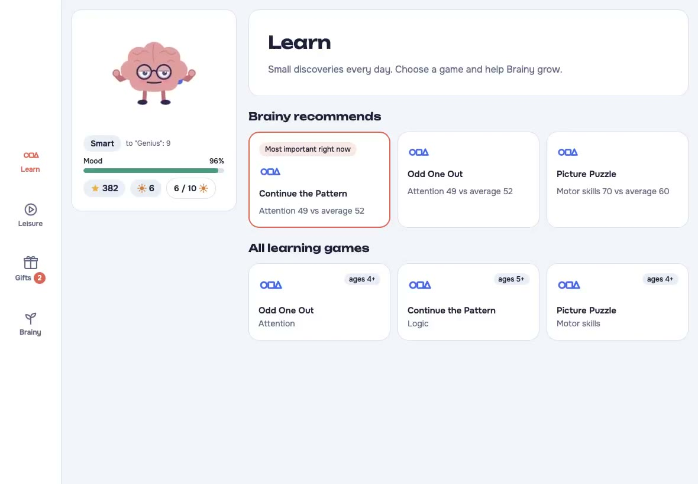
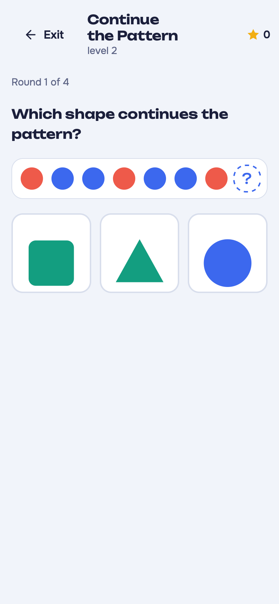
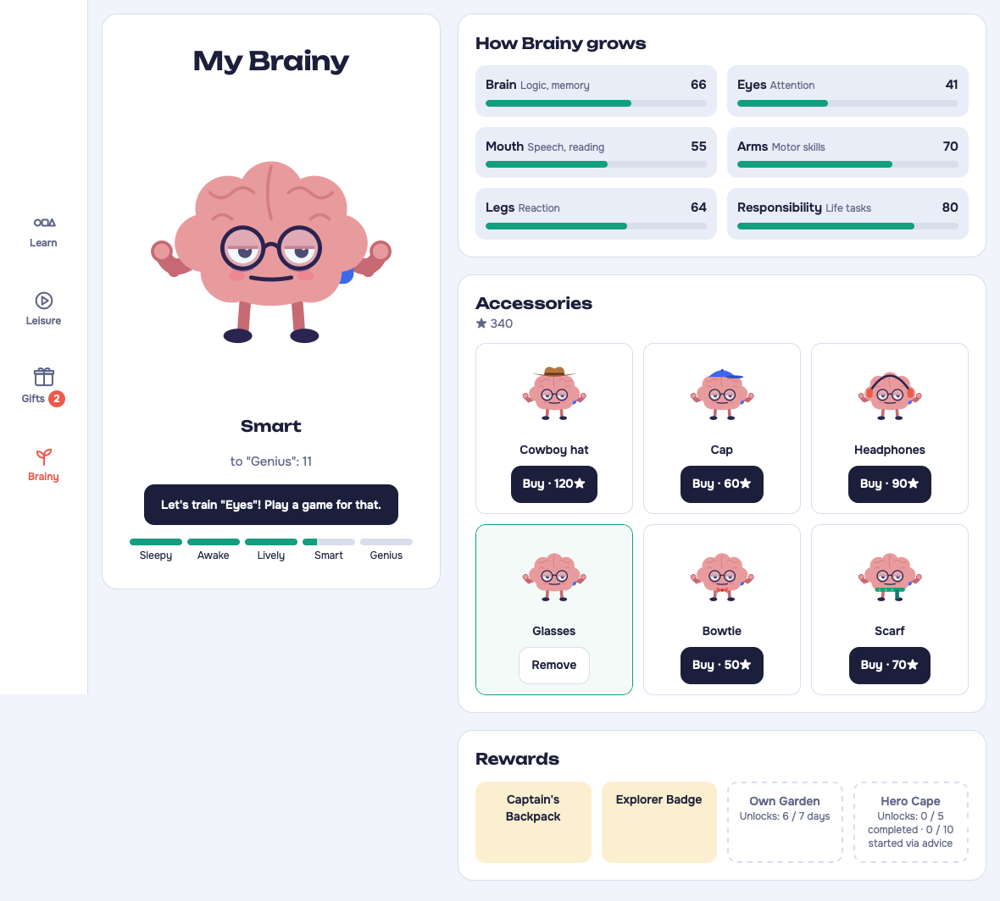
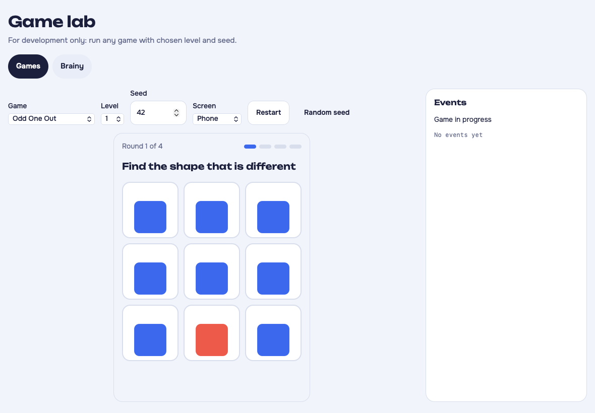
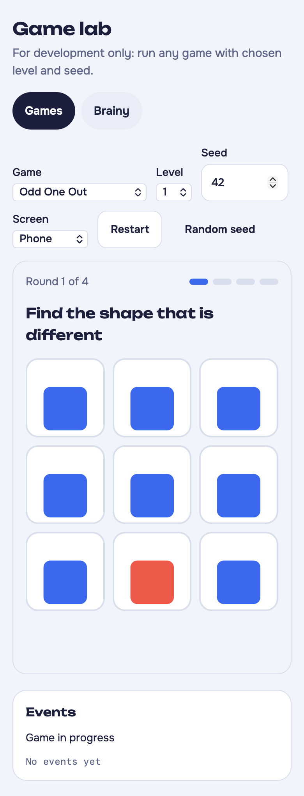

<!-- Generated by pnpm report --module learning. Edit docs/reports/src/learning.md. -->

# Brainee: saved child learning loop

The implemented child features, recorded from a local production build with
`DEMO_MODE=1`, `BRAINEE_LAB=1` and a freshly reset seeded database. Rewards and
Brainy stats are saved through the session API and read back by polling. The
full child/parent walkthrough is in the [MVP report](mvp.md).
[Run instructions](README.md#learning-module).

## Recordings

Each English walkthrough starts on Learn, plays Continue the Pattern from the
grid, opens Odd One Out directly, then chooses its next level. Each post-game
screen shows stars and Brainy before → after. The third finish adds the +5 ★
break bonus; “Take a break” ends on the Brainy tab. The flow checks the updated
wallet and visits the other child tabs. Pattern answers are tried in order to
exercise hints and correction rewards. Achievement celebrations are dismissed
before continuing. The weak-skill card is shown; its iframe game is outside
this native-game recording helper. The games-owned loading text may still appear
in Russian briefly; T-112 belongs to the separate games session.

### Phone · 390 × 844

**Phone: three saved games, break and child tabs** (flow `phone-learning`): PASSED, 27 of 27 checks passed, 50.9 s, phone. Recorded Nov 14, 2026, 1:47 p.m. (America/New_York) against `http://127.0.0.1:3132/learn`.

Timeline: 59 entries

| Time | Source | Entry |
| --- | --- | --- |
| 00:01.810 | step | open /learn |
| 00:03.647 | check | Learn opens with saved state |
| 00:03.689 | check | The Brainy dock shows the saved wallet |
| 00:03.700 | check | The document language is English |
| 00:03.700 | check | The screen fits without horizontal scrolling |
| 00:03.700 | check | The two self-hosted font families load |
| 00:03.700 | step | call checkSurface |
| 00:04.927 | step | wait 1200 |
| 00:04.927 | mark | Game 1: open Continue the pattern from the Learn grid |
| 00:05.961 | step | click {"by":"role","role":"link","name":"ages 5+ Continue the Pattern Logic","exact":true} |
| 00:06.063 | check | The game opens fullscreen |
| 00:06.912 | mark | Play Continue the pattern |
| 00:15.198 | check | Four rounds played (1 corrected) |
| 00:15.198 | step | call playGame |
| 00:16.563 | check | Game 1: «Game completed!» shows stars and Brainy before → after |
| 00:16.569 | check | No break suggestion before the third game |
| 00:19.279 | step | call showPostGame |
| 00:19.279 | mark | Game 2: next game practice card |
| 00:21.681 | step | goto /game/odd-one-out |
| 00:21.711 | mark | Play Odd one out |
| 00:27.047 | check | Four rounds played |
| 00:27.047 | step | call playGame |
| 00:27.885 | check | Game 2: «Game completed!» shows stars and Brainy before → after |
| 00:27.886 | check | No break suggestion before the third game |
| 00:30.595 | step | call showPostGame |
| 00:30.595 | mark | Game 3: next level card |
| 00:30.730 | step | click {"by":"testId","value":"next-level"} |
| 00:30.954 | mark | Play Odd one out |
| 00:36.310 | check | Four rounds played |
| 00:36.310 | step | call playGame |
| 00:37.397 | check | Game 3: «Game completed!» shows stars and Brainy before → after |
| 00:37.412 | check | The third game adds today's +5 ★ break bonus |
| 00:40.122 | step | call showPostGame |
| 00:40.123 | mark | Take the suggested break |
| 00:40.294 | step | click {"by":"role","role":"button","name":"Take a break","exact":true} |
| 00:41.177 | check | The break ends on the Brainy tab |
| 00:41.183 | check | Brainy thanks the child |
| 00:41.185 | check | The document language is English |
| 00:41.185 | check | The screen fits without horizontal scrolling |
| 00:41.185 | check | The two self-hosted font families load |
| 00:41.185 | step | call checkSurface |
| 00:42.697 | step | wait 1500 |
| 00:42.697 | mark | Visit the other tabs |
| 00:42.808 | step | click {"by":"role","role":"link","name":"Learn","exact":true} |
| 00:43.143 | check | Learn shows the updated wallet |
| 00:44.149 | step | wait 1000 |
| 00:44.350 | step | click {"by":"role","role":"link","name":"Leisure","exact":true} |
| 00:44.555 | check | Leisure placeholder (T-36) |
| 00:45.363 | step | wait 800 |
| 00:45.395 | step | click {"by":"role","role":"link","name":"Gifts","exact":true} |
| 00:45.504 | check | Gifts placeholder (T-38) |
| 00:46.307 | step | wait 800 |
| 00:46.434 | step | click {"by":"role","role":"link","name":"Open Brainy","exact":true} |
| 00:46.534 | check | The dock opens the Brainy tab |
| 00:46.550 | check | The document language is English |
| 00:46.550 | check | The screen fits without horizontal scrolling |
| 00:46.550 | check | The two self-hosted font families load |
| 00:46.550 | step | call checkSurface |
| 00:47.751 | step | wait 1200 |

### iPad viewport · 1180 × 820 landscape

**iPad viewport: three saved games, break and child tabs** (flow `ipad-learning`): PASSED, 27 of 27 checks passed, 46.1 s, ipad. Recorded Nov 14, 2026, 1:48 p.m. (America/New_York) against `http://127.0.0.1:3132/learn`.

Timeline: 59 entries

| Time | Source | Entry |
| --- | --- | --- |
| 00:00.692 | step | open /learn |
| 00:02.428 | check | Learn opens with saved state |
| 00:02.431 | check | The Brainy dock shows the saved wallet |
| 00:02.432 | check | The document language is English |
| 00:02.432 | check | The screen fits without horizontal scrolling |
| 00:02.432 | check | The two self-hosted font families load |
| 00:02.432 | step | call checkSurface |
| 00:03.634 | step | wait 1200 |
| 00:03.634 | mark | Game 1: open Continue the pattern from the Learn grid |
| 00:03.678 | step | click {"by":"role","role":"link","name":"ages 5+ Continue the Pattern Logic","exact":true} |
| 00:03.781 | check | The game opens fullscreen |
| 00:04.599 | mark | Play Continue the pattern |
| 00:14.970 | check | Four rounds played (3 corrected) |
| 00:14.970 | step | call playGame |
| 00:15.707 | check | Game 1: «Game completed!» shows stars and Brainy before → after |
| 00:15.708 | check | No break suggestion before the third game |
| 00:18.410 | step | call showPostGame |
| 00:18.410 | mark | Game 2: next game practice card |
| 00:19.972 | step | goto /game/odd-one-out |
| 00:19.986 | mark | Play Odd one out |
| 00:24.849 | check | Four rounds played |
| 00:24.849 | step | call playGame |
| 00:25.639 | check | Game 2: «Game completed!» shows stars and Brainy before → after |
| 00:25.642 | check | No break suggestion before the third game |
| 00:28.350 | step | call showPostGame |
| 00:28.350 | mark | Game 3: next level card |
| 00:28.384 | step | click {"by":"testId","value":"next-level"} |
| 00:28.460 | mark | Play Odd one out |
| 00:33.336 | check | Four rounds played |
| 00:33.336 | step | call playGame |
| 00:34.071 | check | Game 3: «Game completed!» shows stars and Brainy before → after |
| 00:34.087 | check | Today's bonus is already claimed; the break still appears |
| 00:36.804 | step | call showPostGame |
| 00:36.804 | mark | Take the suggested break |
| 00:36.899 | step | click {"by":"role","role":"button","name":"Take a break","exact":true} |
| 00:37.702 | check | The break ends on the Brainy tab |
| 00:37.705 | check | Brainy thanks the child |
| 00:37.706 | check | The document language is English |
| 00:37.706 | check | The screen fits without horizontal scrolling |
| 00:37.706 | check | The two self-hosted font families load |
| 00:37.706 | step | call checkSurface |
| 00:39.207 | step | wait 1500 |
| 00:39.207 | mark | Visit the other tabs |
| 00:39.231 | step | click {"by":"role","role":"link","name":"Learn","exact":true} |
| 00:39.256 | check | Learn shows the updated wallet |
| 00:40.257 | step | wait 1000 |
| 00:40.298 | step | click {"by":"role","role":"link","name":"Leisure","exact":true} |
| 00:40.323 | check | Leisure placeholder (T-36) |
| 00:41.124 | step | wait 800 |
| 00:41.147 | step | click {"by":"role","role":"link","name":"Gifts","exact":true} |
| 00:41.175 | check | Gifts placeholder (T-38) |
| 00:41.976 | step | wait 800 |
| 00:41.998 | step | click {"by":"role","role":"link","name":"Open Brainy","exact":true} |
| 00:42.100 | check | The dock opens the Brainy tab |
| 00:42.101 | check | The document language is English |
| 00:42.101 | check | The screen fits without horizontal scrolling |
| 00:42.101 | check | The two self-hosted font families load |
| 00:42.101 | step | call checkSurface |
| 00:43.302 | step | wait 1200 |

Recorded in WebKit with English UI and New York time at the named viewport sizes. `pnpm e2e` covers Chromium
and WebKit; this is not a real-device or Screen Time test.

## Screenshots

### Learn

| iPad (1180 × 820 landscape) | Phone (390 × 844) |
| --- | --- |
|  |  |
| _learn_ | _learn_ |

### Odd one out

| iPad (1180 × 820 landscape) | Phone (390 × 844) |
| --- | --- |
|  |  |
| _odd-one-out_ | _odd-one-out_ |

### Continue the pattern, level 2

| iPad (1180 × 820 landscape) | Phone (390 × 844) |
| --- | --- |
|  |  |
| _continue-pattern_ | _continue-pattern_ |

### Brainy tab

| iPad (1180 × 820 landscape) | Phone (390 × 844) |
| --- | --- |
|  |  |
| _brainy_ | _brainy_ |

### Developer lab (`/lab`, not in the product)

| iPad (1180 × 820 landscape) | Phone (390 × 844) |
| --- | --- |
|  |  |
| _lab_ | _lab_ |

| iPad (1180 × 820 landscape) | Phone (390 × 844) |
| --- | --- |
|  |  |
| _lab-brainy_ | _lab-brainy_ |

## Logs and capture checks

[Download the flow timelines (JSON)](logs/learning.json).

Captured Nov 14, 2026, 1:40 p.m. (America/New_York): 12 scenarios, ipad and phone; English, light theme. No failed steps, redirects, JavaScript errors, HTTP errors or unexpected failed requests. 0 known lifecycle request cancellations remain in the manifest. Source: `acb2423` with working-tree changes. Imported static references are not live captures. Flows: `phone-learning` PASSED (27 checks), `ipad-learning` PASSED (27 checks). Timelines: [JSON log](logs/learning.json).

The editable [template](src/learning.md), [scenario](../../scripts/reports/scenarios/learning.json)
and [walkthrough actions](../../scripts/reports/scenarios/learning.mjs) define
what this report captures.
