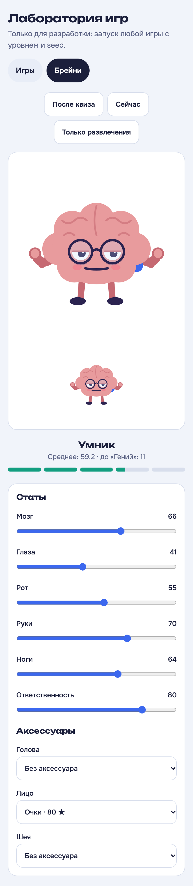

<!-- Generated by pnpm report --module learning. Edit docs/reports/src/learning.md. -->

# Brainee: saved child learning loop

The implemented child features, recorded from a local production build with
`DEMO_MODE=1`, `BRAINEE_LAB=1` and a freshly reset seeded database. Rewards and
Brainy stats are saved through the session API and read back by polling. The
parent view, entry screen, Leisure and Gifts are not implemented yet.
[Run instructions](README.md#learning-module).

## Recordings

Each walkthrough starts on «Учимся» and plays three games without returning to
the menu: Continue the pattern from the grid, then the «Подтянуть навык» card
(a game for the weakest skill), then the «Следующий уровень» card. Each
post-game screen shows stars and Brainy before → after. The third adds the
+5 ★ bonus and «Сделать перерыв», which ends on the Brainy tab with a
thank-you. Then it checks the updated wallet and visits the other tabs.
Continue the pattern is answered by trying options in order, so wrong tries
show the hint «Почти!» and the correction star.

### Phone · 390 × 844

**Phone: three saved games, break and child tabs** (flow `phone-learning`): PASSED, 27 of 27 checks passed, 43.6 s, phone. Recorded Nov 14, 2026, 6:00 p.m. (Asia/Almaty) against `http://127.0.0.1:3123/learn`.

Timeline: 59 entries

| Time | Source | Entry |
| --- | --- | --- |
| 00:00.058 | step | open /learn |
| 00:01.629 | check | Learn opens with saved state |
| 00:01.632 | check | The Brainy dock shows the saved wallet |
| 00:01.635 | check | The document language is Russian |
| 00:01.635 | check | The screen fits without horizontal scrolling |
| 00:01.635 | check | The two self-hosted font families load |
| 00:01.635 | step | call checkSurface |
| 00:02.837 | step | wait 1200 |
| 00:02.837 | mark | Game 1: open Continue the pattern from the Learn grid |
| 00:02.945 | step | click {"by":"role","role":"link","name":"Продолжи узор Логика","exact":true} |
| 00:03.046 | check | The game opens fullscreen |
| 00:03.327 | mark | Play Continue the pattern |
| 00:17.206 | check | Four rounds played (5 corrected) |
| 00:17.206 | step | call playGame |
| 00:17.235 | check | Game 1: «Игра пройдена!» shows stars and Brainy before → after |
| 00:17.236 | check | No break suggestion before the third game |
| 00:19.942 | step | call showPostGame |
| 00:19.942 | mark | Game 2: «Что дальше?» practice card |
| 00:19.955 | step | click {"by":"testId","value":"practice-game"} |
| 00:20.740 | mark | Play Odd one out |
| 00:25.555 | check | Four rounds played |
| 00:25.555 | step | call playGame |
| 00:25.580 | check | Game 2: «Игра пройдена!» shows stars and Brainy before → after |
| 00:25.580 | check | No break suggestion before the third game |
| 00:28.287 | step | call showPostGame |
| 00:28.287 | mark | Game 3: next level card |
| 00:28.305 | step | click {"by":"testId","value":"next-level"} |
| 00:28.382 | mark | Play Odd one out |
| 00:33.136 | check | Four rounds played |
| 00:33.136 | step | call playGame |
| 00:33.162 | check | Game 3: «Игра пройдена!» shows stars and Brainy before → after |
| 00:33.164 | check | The third game adds the one-time +5 ★ break bonus |
| 00:35.869 | step | call showPostGame |
| 00:35.869 | mark | Take the suggested break |
| 00:35.888 | step | click {"by":"role","role":"button","name":"Сделать перерыв","exact":true} |
| 00:35.921 | check | The break ends on the Brainy tab |
| 00:35.926 | check | Brainy thanks the child |
| 00:35.927 | check | The document language is Russian |
| 00:35.927 | check | The screen fits without horizontal scrolling |
| 00:35.927 | check | The two self-hosted font families load |
| 00:35.927 | step | call checkSurface |
| 00:37.428 | step | wait 1500 |
| 00:37.428 | mark | Visit the other tabs |
| 00:37.454 | step | click {"by":"role","role":"link","name":"Учимся","exact":true} |
| 00:37.528 | check | Learn shows the updated wallet |
| 00:38.529 | step | wait 1000 |
| 00:38.552 | step | click {"by":"role","role":"link","name":"Отдых","exact":true} |
| 00:38.628 | check | Leisure placeholder (T-36) |
| 00:39.429 | step | wait 800 |
| 00:39.453 | step | click {"by":"role","role":"link","name":"Подарки","exact":true} |
| 00:39.529 | check | Gifts placeholder (T-38) |
| 00:40.331 | step | wait 800 |
| 00:40.353 | step | click {"by":"role","role":"link","name":"Открыть Брейни","exact":true} |
| 00:40.455 | check | The dock opens the Brainy tab |
| 00:40.457 | check | The document language is Russian |
| 00:40.457 | check | The screen fits without horizontal scrolling |
| 00:40.457 | check | The two self-hosted font families load |
| 00:40.457 | step | call checkSurface |
| 00:41.659 | step | wait 1200 |

### iPad viewport · 820 × 1180

**iPad viewport: three saved games, break and child tabs** (flow `ipad-learning`): PASSED, 27 of 27 checks passed, 40.3 s, ipad. Recorded Nov 14, 2026, 6:01 p.m. (Asia/Almaty) against `http://127.0.0.1:3123/learn`.

Timeline: 59 entries

| Time | Source | Entry |
| --- | --- | --- |
| 00:00.075 | step | open /learn |
| 00:01.634 | check | Learn opens with saved state |
| 00:01.636 | check | The Brainy dock shows the saved wallet |
| 00:01.636 | check | The document language is Russian |
| 00:01.636 | check | The screen fits without horizontal scrolling |
| 00:01.636 | check | The two self-hosted font families load |
| 00:01.636 | step | call checkSurface |
| 00:02.838 | step | wait 1200 |
| 00:02.838 | mark | Game 1: open Continue the pattern from the Learn grid |
| 00:02.858 | step | click {"by":"role","role":"link","name":"Продолжи узор Логика","exact":true} |
| 00:02.959 | check | The game opens fullscreen |
| 00:03.239 | mark | Play Continue the pattern |
| 00:13.457 | check | Four rounds played (3 corrected) |
| 00:13.457 | step | call playGame |
| 00:13.487 | check | Game 1: «Игра пройдена!» shows stars and Brainy before → after |
| 00:13.488 | check | No break suggestion before the third game |
| 00:16.194 | step | call showPostGame |
| 00:16.194 | mark | Game 2: «Что дальше?» practice card |
| 00:16.219 | step | click {"by":"testId","value":"practice-game"} |
| 00:17.001 | mark | Play Odd one out |
| 00:21.736 | check | Four rounds played |
| 00:21.736 | step | call playGame |
| 00:21.761 | check | Game 2: «Игра пройдена!» shows stars and Brainy before → after |
| 00:21.762 | check | No break suggestion before the third game |
| 00:24.467 | step | call showPostGame |
| 00:24.467 | mark | Game 3: next level card |
| 00:24.488 | step | click {"by":"testId","value":"next-level"} |
| 00:24.565 | mark | Play Odd one out |
| 00:29.300 | check | Four rounds played |
| 00:29.300 | step | call playGame |
| 00:29.326 | check | Game 3: «Игра пройдена!» shows stars and Brainy before → after |
| 00:29.328 | check | The third game adds the one-time +5 ★ break bonus |
| 00:32.032 | step | call showPostGame |
| 00:32.032 | mark | Take the suggested break |
| 00:32.056 | step | click {"by":"role","role":"button","name":"Сделать перерыв","exact":true} |
| 00:32.086 | check | The break ends on the Brainy tab |
| 00:32.089 | check | Brainy thanks the child |
| 00:32.089 | check | The document language is Russian |
| 00:32.089 | check | The screen fits without horizontal scrolling |
| 00:32.089 | check | The two self-hosted font families load |
| 00:32.089 | step | call checkSurface |
| 00:33.591 | step | wait 1500 |
| 00:33.591 | mark | Visit the other tabs |
| 00:33.600 | step | click {"by":"role","role":"link","name":"Учимся","exact":true} |
| 00:33.674 | check | Learn shows the updated wallet |
| 00:34.677 | step | wait 1000 |
| 00:34.703 | step | click {"by":"role","role":"link","name":"Отдых","exact":true} |
| 00:34.781 | check | Leisure placeholder (T-36) |
| 00:35.584 | step | wait 800 |
| 00:35.609 | step | click {"by":"role","role":"link","name":"Подарки","exact":true} |
| 00:35.661 | check | Gifts placeholder (T-38) |
| 00:36.463 | step | wait 800 |
| 00:36.483 | step | click {"by":"role","role":"link","name":"Открыть Брейни","exact":true} |
| 00:36.585 | check | The dock opens the Brainy tab |
| 00:36.586 | check | The document language is Russian |
| 00:36.586 | check | The screen fits without horizontal scrolling |
| 00:36.586 | check | The two self-hosted font families load |
| 00:36.586 | step | call checkSurface |
| 00:37.788 | step | wait 1200 |

Recorded in Chromium at the named viewport sizes. `pnpm e2e` covers Chromium
and WebKit; this is not a real-device or Screen Time test.

## Screenshots

### Learn

| iPad (820 × 1180) | Phone (390 × 844) |
| --- | --- |
|  |  |
| _learn_ | _learn_ |

### Odd one out

| iPad (820 × 1180) | Phone (390 × 844) |
| --- | --- |
|  |  |
| _odd-one-out_ | _odd-one-out_ |

### Continue the pattern, level 2

| iPad (820 × 1180) | Phone (390 × 844) |
| --- | --- |
|  |  |
| _continue-pattern_ | _continue-pattern_ |

### Brainy tab

| iPad (820 × 1180) | Phone (390 × 844) |
| --- | --- |
|  |  |
| _brainy_ | _brainy_ |

### Developer lab (`/lab`, not in the product)

| iPad (820 × 1180) | Phone (390 × 844) |
| --- | --- |
|  |  |
| _lab_ | _lab_ |

| iPad (820 × 1180) | Phone (390 × 844) |
| --- | --- |
|  |  |
| _lab-brainy_ | _lab-brainy_ |

## Logs and capture checks

[Download the flow timelines (JSON)](logs/learning.json).

Captured Nov 14, 2026, 6:00 p.m. (Asia/Almaty): 12 scenarios, ipad and phone; Russian, light theme. No failed steps, redirects, JavaScript errors, HTTP errors or unexpected failed requests. 0 known lifecycle request cancellations remain in the manifest. Source: `09a7732` with working-tree changes. Imported static references are not live captures. Flows: `phone-learning` PASSED (27 checks), `ipad-learning` PASSED (27 checks). Timelines: [JSON log](logs/learning.json).

The editable [template](src/learning.md), [scenario](../../scripts/reports/scenarios/learning.json)
and [walkthrough actions](../../scripts/reports/scenarios/learning.mjs) define
what this report captures.
