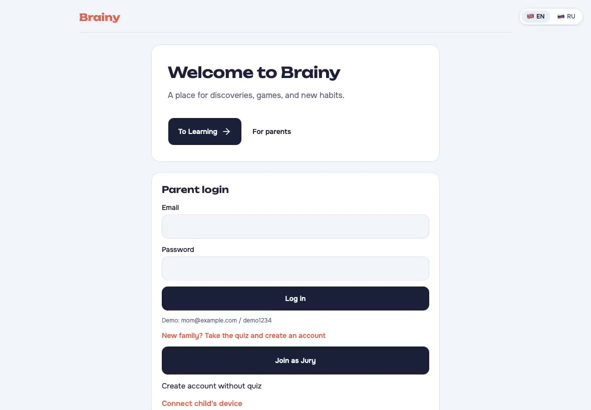
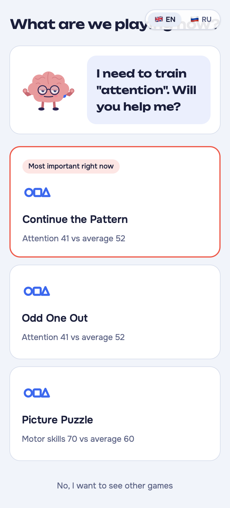
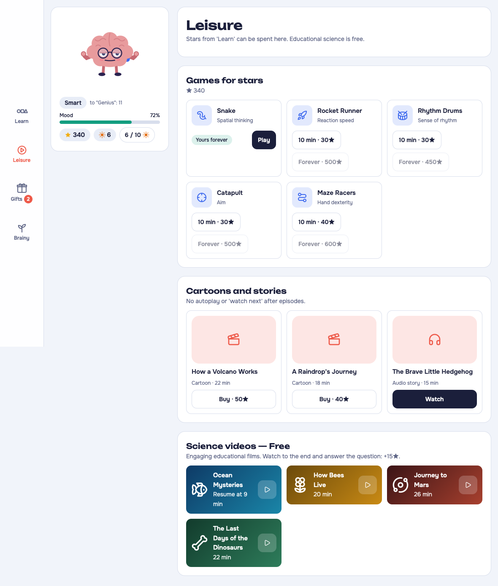
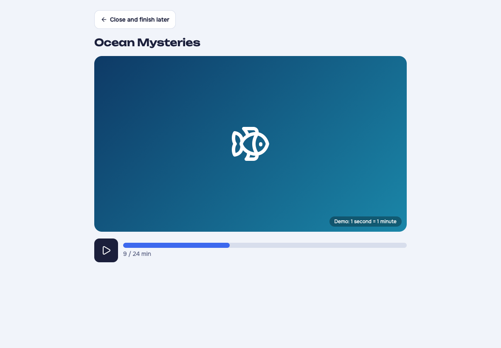
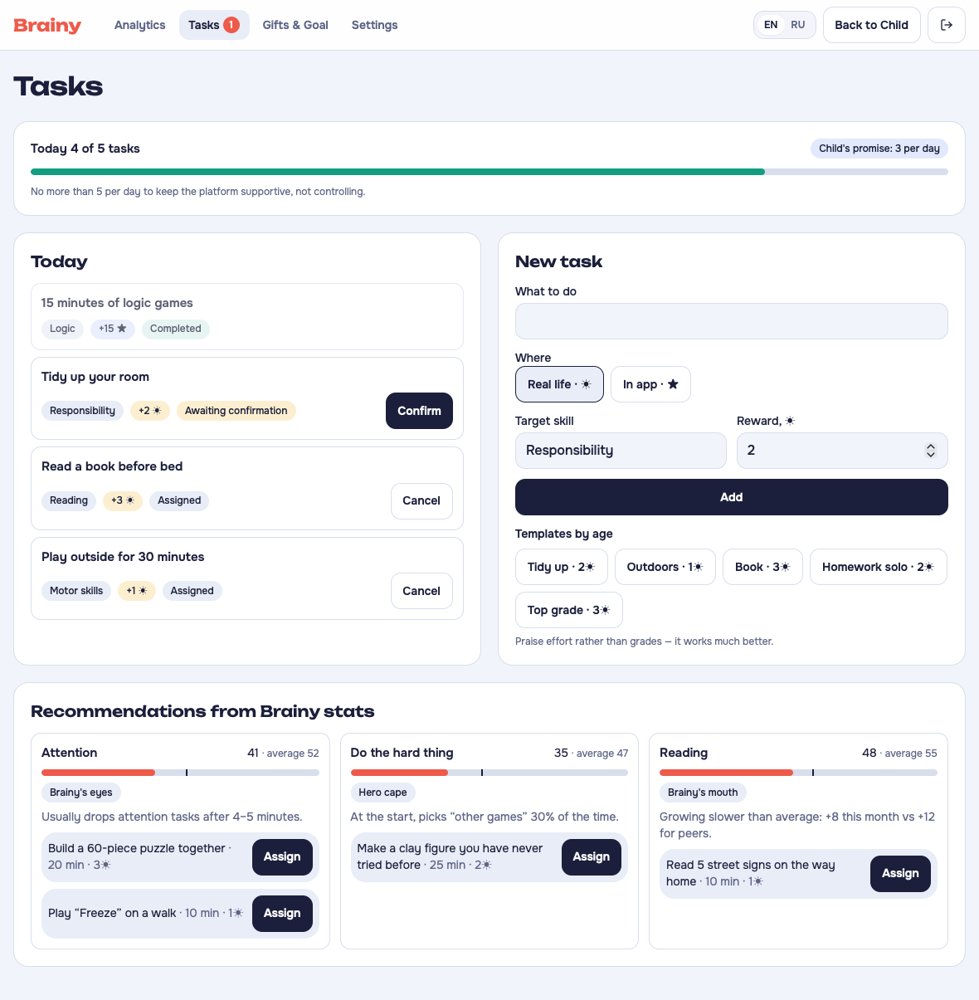

<!-- Generated by pnpm report --module mvp. Edit docs/reports/src/mvp.md. -->

# Brainee: every MVP page, child and parent

All MVP screens, recorded from a local production build with `DEMO_MODE=1` and
a freshly reset seeded database. Rewards, tasks, gifts and accessories are
saved through the demo API and sync between devices by polling. Activity analytics use saved sessions and actions; historical/character
radars and ranking remain labelled demo data. Demo parent PIN: `1234`.
[Run instructions](README.md#mvp-module).

## Recordings

Each walkthrough opens the app on “What shall we play?”, goes to Learn,
browses Leisure, watches a science video to the end (1 s = 1 min) and answers
its quiz (a wrong answer fades, the right one pays +15 ★ once), marks a task
done and exchanges ☀ → ★ in Gifts, and buys an accessory on the Brainy tab.
Then it enters parent mode with the PIN, scrolls Analytics, confirms the
child's task in Tasks and opens Gifts & goal.

### Phone · 390 × 844

**Phone: entry, leisure, video quiz, gifts, Brainy shop, parent** (flow `phone-mvp`): PASSED, 16 of 16 checks passed, 55.8 s, phone. Recorded Nov 14, 2026, 1:41 p.m. (America/New_York) against `http://127.0.0.1:3131/login`.

Timeline: 64 entries

| Time | Source | Entry |
| --- | --- | --- |
| 00:00.709 | step | open /login |
| 00:02.428 | check | Demo content reset to the seed |
| 00:02.428 | step | call resetDemo |
| 00:03.987 | step | goto /entry |
| 00:04.011 | check | Opening the app shows the entry screen |
| 00:05.812 | step | wait 1800 |
| 00:05.812 | mark | Child: other games → Learn |
| 00:05.865 | step | click {"by":"role","role":"link","name":"No, I want to see other games","exact":true} |
| 00:05.949 | check | Learn shows Brainy's advice and the grid |
| 00:07.150 | step | wait 1200 |
| 00:07.150 | mark | Leisure: shop, cartoons, science |
| 00:07.179 | step | click {"by":"role","role":"link","name":"Leisure","exact":true} |
| 00:07.214 | check | Leisure shows the ★ shop |
| 00:07.216 | step | scroll window by 0,700 |
| 00:08.019 | step | wait 800 |
| 00:08.025 | step | scroll window by 0,900 |
| 00:08.826 | step | wait 800 |
| 00:08.826 | mark | Science video: pause-only player and quiz |
| 00:08.842 | step | click {"by":"role","role":"link","name":"How Bees Live"} |
| 00:09.632 | check | The player has only play/pause |
| 00:09.667 | step | click {"by":"role","role":"button","name":"Watch","exact":true} |
| 00:30.084 | check | The quiz appears after the last minute |
| 00:30.136 | step | click {"by":"role","role":"button","name":"Wax","exact":true} |
| 00:30.146 | network (warn) | 409 POST http://127.0.0.1:3131/api/actions |
| 00:30.147 | console (warn) | Failed to load resource: the server responded with a status of 409 (Conflict) |
| 00:31.038 | step | wait 900 |
| 00:31.052 | step | click {"by":"role","role":"button","name":"Honey","exact":true} |
| 00:31.076 | check | Correct answer pays +15★ once |
| 00:32.278 | step | wait 1200 |
| 00:32.302 | step | click {"by":"role","role":"link","name":"Back to Leisure","exact":true} |
| 00:32.302 | mark | Gifts: goal, shop, tasks, exchange |
| 00:33.162 | step | click {"by":"role","role":"link","name":"Gifts","exact":true} |
| 00:33.245 | check | Gifts shows the weekly goal and tasks |
| 00:33.246 | step | scroll window by 0,600 |
| 00:33.988 | check | Child marks a real-life task done → waits for the parent |
| 00:33.988 | step | call childTaskDone |
| 00:34.029 | step | click {"by":"role","role":"button","name":"1 ☀ for 10 ★","exact":true} |
| 00:35.031 | step | wait 1000 |
| 00:35.031 | mark | Brainy: accessory shop |
| 00:35.054 | step | click {"by":"role","role":"link","name":"Brainy","exact":true} |
| 00:35.088 | check | Brainy tab shows stats and the shop |
| 00:35.840 | check | Bought accessory is worn (one per slot) |
| 00:36.745 | step | call buyCheapestAccessory |
| 00:37.946 | step | wait 1200 |
| 00:37.947 | mark | Parent: PIN, analytics, confirm the child's task |
| 00:39.604 | step | goto /analytics |
| 00:39.619 | check | Parent mode is behind a PIN |
| 00:39.655 | step | click {"by":"role","role":"button","name":"Digit 1","exact":true} |
| 00:39.695 | step | click {"by":"role","role":"button","name":"Digit 2","exact":true} |
| 00:39.822 | step | click {"by":"role","role":"button","name":"Digit 3","exact":true} |
| 00:39.877 | step | click {"by":"role","role":"button","name":"Digit 4","exact":true} |
| 00:40.063 | check | Analytics: radars, bars, ranking |
| 00:41.064 | step | wait 1000 |
| 00:44.079 | step | call scrollPage |
| 00:44.103 | step | click {"by":"role","role":"button","name":"City","exact":true} |
| 00:44.905 | step | wait 800 |
| 00:44.935 | step | call openParentTab |
| 00:44.962 | check | Tasks: Today list with confirmations |
| 00:45.880 | check | Parent confirms → ☀ and weekly goal grow |
| 00:46.781 | step | call confirmTask |
| 00:49.815 | step | call scrollPage |
| 00:49.836 | step | call openParentTab |
| 00:49.913 | check | Gifts & goal: requests and shop |
| 00:52.936 | step | call scrollPage |

### iPad viewport · 1180 × 820 landscape

**iPad viewport: entry, leisure, video quiz, gifts, Brainy shop, parent** (flow `ipad-mvp`): PASSED, 16 of 16 checks passed, 60.3 s, ipad. Recorded Nov 14, 2026, 1:42 p.m. (America/New_York) against `http://127.0.0.1:3131/login`.

Timeline: 64 entries

| Time | Source | Entry |
| --- | --- | --- |
| 00:00.587 | step | open /login |
| 00:02.267 | check | Demo content reset to the seed |
| 00:02.267 | step | call resetDemo |
| 00:03.867 | step | goto /entry |
| 00:03.914 | check | Opening the app shows the entry screen |
| 00:05.720 | step | wait 1800 |
| 00:05.720 | mark | Child: other games → Learn |
| 00:05.793 | step | click {"by":"role","role":"link","name":"No, I want to see other games","exact":true} |
| 00:05.887 | check | Learn shows Brainy's advice and the grid |
| 00:07.093 | step | wait 1200 |
| 00:07.093 | mark | Leisure: shop, cartoons, science |
| 00:07.155 | step | click {"by":"role","role":"link","name":"Leisure","exact":true} |
| 00:07.336 | check | Leisure shows the ★ shop |
| 00:07.358 | step | scroll window by 0,700 |
| 00:08.161 | step | wait 800 |
| 00:08.172 | step | scroll window by 0,900 |
| 00:08.974 | step | wait 800 |
| 00:08.974 | mark | Science video: pause-only player and quiz |
| 00:08.999 | step | click {"by":"role","role":"link","name":"How Bees Live"} |
| 00:09.416 | check | The player has only play/pause |
| 00:09.459 | step | click {"by":"role","role":"button","name":"Watch","exact":true} |
| 00:29.569 | check | The quiz appears after the last minute |
| 00:29.625 | step | click {"by":"role","role":"button","name":"Wax","exact":true} |
| 00:29.635 | network (warn) | 409 POST http://127.0.0.1:3131/api/actions |
| 00:29.636 | console (warn) | Failed to load resource: the server responded with a status of 409 (Conflict) |
| 00:30.527 | step | wait 900 |
| 00:30.609 | step | click {"by":"role","role":"button","name":"Honey","exact":true} |
| 00:30.728 | check | Correct answer pays +15★ once |
| 00:31.930 | step | wait 1200 |
| 00:32.017 | step | click {"by":"role","role":"link","name":"Back to Leisure","exact":true} |
| 00:32.017 | mark | Gifts: goal, shop, tasks, exchange |
| 00:32.446 | step | click {"by":"role","role":"link","name":"Gifts","exact":true} |
| 00:32.549 | check | Gifts shows the weekly goal and tasks |
| 00:32.552 | step | scroll window by 0,600 |
| 00:33.366 | check | Child marks a real-life task done → waits for the parent |
| 00:33.366 | step | call childTaskDone |
| 00:33.443 | step | click {"by":"role","role":"button","name":"1 ☀ for 10 ★","exact":true} |
| 00:34.448 | step | wait 1000 |
| 00:34.448 | mark | Brainy: accessory shop |
| 00:34.491 | step | click {"by":"role","role":"link","name":"Brainy","exact":true} |
| 00:34.586 | check | Brainy tab shows stats and the shop |
| 00:35.453 | check | Bought accessory is worn (one per slot) |
| 00:36.376 | step | call buyCheapestAccessory |
| 00:37.581 | step | wait 1200 |
| 00:37.581 | mark | Parent: PIN, analytics, confirm the child's task |
| 00:39.270 | step | goto /analytics |
| 00:39.312 | check | Parent mode is behind a PIN |
| 00:39.400 | step | click {"by":"role","role":"button","name":"Digit 1","exact":true} |
| 00:39.451 | step | click {"by":"role","role":"button","name":"Digit 2","exact":true} |
| 00:39.498 | step | click {"by":"role","role":"button","name":"Digit 3","exact":true} |
| 00:39.542 | step | click {"by":"role","role":"button","name":"Digit 4","exact":true} |
| 00:39.742 | check | Analytics: radars, bars, ranking |
| 00:40.745 | step | wait 1000 |
| 00:43.771 | step | call scrollPage |
| 00:43.797 | step | click {"by":"role","role":"button","name":"City","exact":true} |
| 00:44.598 | step | wait 800 |
| 00:44.719 | step | call openParentTab |
| 00:45.051 | check | Tasks: Today list with confirmations |
| 00:45.420 | check | Parent confirms → ☀ and weekly goal grow |
| 00:46.330 | step | call confirmTask |
| 00:49.366 | step | call scrollPage |
| 00:49.421 | step | call openParentTab |
| 00:49.535 | check | Gifts & goal: requests and shop |
| 00:52.558 | step | call scrollPage |

## Child screens

### Entry “What shall we play?”

| iPad (1180 × 820 landscape) | Phone (390 × 844) |
| --- | --- |
|  |  |
| _entry_ | _entry_ |

### Learn

| iPad (1180 × 820 landscape) | Phone (390 × 844) |
| --- | --- |
|  |  |
| _learn_ | _learn_ |

### Leisure

| iPad (1180 × 820 landscape) | Phone (390 × 844) |
| --- | --- |
|  |  |
| _leisure_ | _leisure_ |

### Science video player

| iPad (1180 × 820 landscape) | Phone (390 × 844) |
| --- | --- |
|  |  |
| _video_ | _video_ |

### Gifts

| iPad (1180 × 820 landscape) | Phone (390 × 844) |
| --- | --- |
|  |  |
| _gifts_ | _gifts_ |

### Brainy

| iPad (1180 × 820 landscape) | Phone (390 × 844) |
| --- | --- |
|  |  |
| _brainy_ | _brainy_ |

## Parent screens

### PIN barrier

| iPad (1180 × 820 landscape) | Phone (390 × 844) |
| --- | --- |
|  |  |
| _parent-pin_ | _parent-pin_ |

### Analytics

| iPad (1180 × 820 landscape) | Phone (390 × 844) |
| --- | --- |
|  |  |
| _analytics_ | _analytics_ |

### Tasks

| iPad (1180 × 820 landscape) | Phone (390 × 844) |
| --- | --- |
|  |  |
| _tasks_ | _tasks_ |

### Gifts & goal

| iPad (1180 × 820 landscape) | Phone (390 × 844) |
| --- | --- |
|  |  |
| _rewards_ | _rewards_ |

## Logs and capture checks

[Download the flow timelines (JSON)](logs/mvp.json).

Captured Nov 14, 2026, 1:41 p.m. (America/New_York): 20 scenarios, ipad and phone; English, light theme. No failed steps, redirects, JavaScript errors, HTTP errors or unexpected failed requests. 0 known lifecycle request cancellations remain in the manifest. Source: `acb2423` with working-tree changes. Imported static references are not live captures. Flows: `phone-mvp` PASSED (16 checks), `ipad-mvp` PASSED (16 checks). Timelines: [JSON log](logs/mvp.json).

The editable [template](src/mvp.md), [scenario](../../scripts/reports/scenarios/mvp.json)
and [walkthrough actions](../../scripts/reports/scenarios/mvp.mjs) define what
this report captures. Recorded in WebKit with English UI and New York time; `pnpm e2e` covers Chromium and WebKit.
