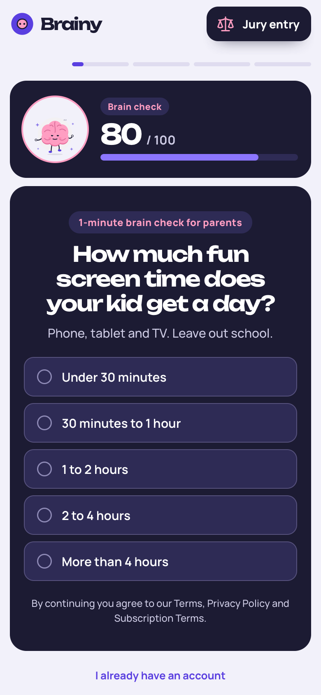
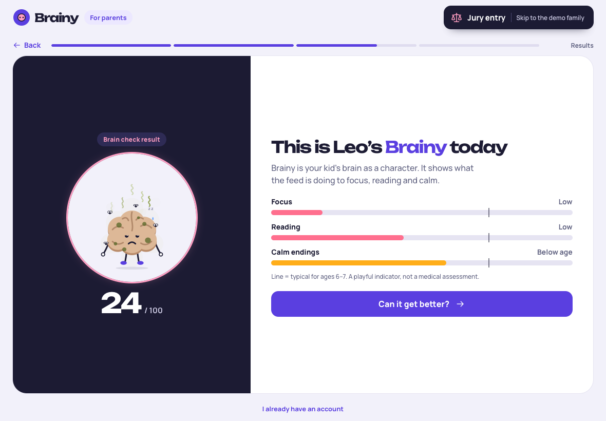
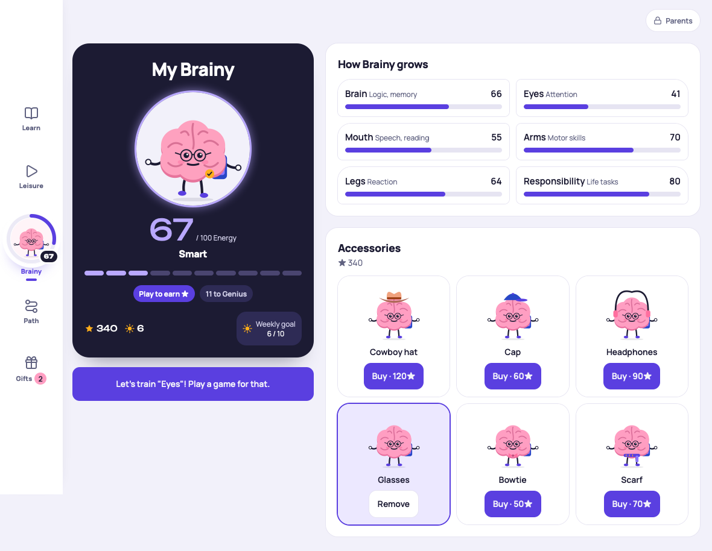
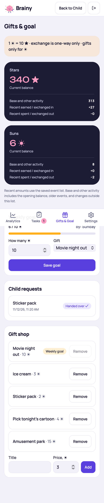

<!-- Generated by pnpm report --module mvp. Edit docs/reports/src/mvp.md. -->

# Brainee: every MVP page, child and parent

All MVP screens, recorded from a local production build with `DEMO_MODE=1` and
a freshly reset seeded database. Rewards, tasks, gifts and accessories are
saved through the demo API and sync between devices by polling. Activity analytics use saved sessions and actions; historical/character
radars and ranking remain labelled demo data. Demo parent PIN: `1234`.
[Run instructions](README.md#mvp-module).

## Recordings

Each walkthrough first answers the parent Brain Check funnel (`/start?tour=1`):
the brain meter drops with each habit answer, the result shows the child's Brainy
today, the plan builder picks minutes and a gift, and the run stops on the offer
(display-only prices, no payment) without creating a family. It then opens the
app on “What are we playing now?”, goes to Learn, browses Leisure's fun-game shop
and films, marks a task done and exchanges ☀ → ★ in Gifts, buys an accessory on
the Brainy tab, and visits Path for weekly learning, stages and discoveries.
Then it enters parent mode with the PIN, scrolls Analytics, confirms the
child's task in Tasks and opens Gifts & goal.

### Phone · 390 × 844

**Phone: parent preview, entry, leisure, gifts, Brainy, Path, parent** (flow `phone-mvp`): PASSED, 22 of 22 checks passed, 68.7 s, phone. Recorded Nov 14, 2026, 10:09 p.m. (America/New_York) against `http://127.0.0.1:3123/login`.

Timeline: 67 entries

| Time | Source | Entry |
| --- | --- | --- |
| 00:00.327 | step | open /login |
| 00:01.945 | check | Demo content reset to the seed |
| 00:01.945 | step | call resetDemo |
| 00:01.945 | mark | Parent Brain Check funnel: habits, brain meter, result, plan and offer |
| 00:09.856 | check | The brain meter drops as the parent answers the habit questions |
| 00:33.389 | check | Funnel ends on the offer: display-only prices, no payment (D-41) |
| 00:37.603 | step | call walkFunnel |
| 00:37.605 | check | The document language is English |
| 00:37.605 | check | The screen fits without horizontal scrolling |
| 00:37.605 | check | The two self-hosted font families load |
| 00:37.605 | step | call checkSurface |
| 00:39.166 | step | goto /entry |
| 00:39.185 | check | Opening the app shows the entry screen |
| 00:40.986 | step | wait 1800 |
| 00:40.986 | mark | Child: other games → Learn |
| 00:41.034 | step | click {"by":"role","role":"link","name":"No, I want to see other games","exact":true} |
| 00:41.068 | check | Learn shows Brainy's advice and the grid |
| 00:42.269 | step | wait 1200 |
| 00:42.269 | mark | Leisure: fun-game shop and films |
| 00:42.303 | step | click {"by":"role","role":"link","name":"Leisure","exact":true} |
| 00:42.337 | check | Leisure shows the ★ shop |
| 00:42.340 | step | scroll window by 0,700 |
| 00:43.142 | step | wait 800 |
| 00:43.146 | step | scroll window by 0,900 |
| 00:43.947 | step | wait 800 |
| 00:43.947 | mark | Gifts: goal, shop, tasks, exchange |
| 00:43.988 | step | click {"by":"role","role":"link","name":"Gifts","exact":true} |
| 00:44.022 | check | Gifts shows the weekly goal and tasks |
| 00:44.024 | step | scroll window by 0,600 |
| 00:44.777 | check | Child marks a real-life task done → waits for the parent |
| 00:44.777 | step | call childTaskDone |
| 00:44.801 | step | click {"by":"role","role":"button","name":"1 ☀ for 10 ★","exact":true} |
| 00:45.803 | step | wait 1000 |
| 00:45.803 | mark | Brainy: accessory shop |
| 00:45.861 | step | click {"by":"css","value":"nav a[href=\"/brainy\"]"} |
| 00:45.888 | check | Brainy tab shows stats and the shop |
| 00:46.684 | check | Bought accessory is worn (one per slot) |
| 00:47.586 | step | call buyCheapestAccessory |
| 00:48.788 | step | wait 1200 |
| 00:48.788 | mark | Path: weekly learning, growth stages and discoveries |
| 00:48.819 | step | click {"by":"role","role":"link","name":"Path","exact":true} |
| 00:48.846 | check | Path shows the stage journey and discoveries |
| 00:48.847 | check | The document language is English |
| 00:48.847 | check | The screen fits without horizontal scrolling |
| 00:48.847 | check | The two self-hosted font families load |
| 00:48.847 | step | call checkSurface |
| 00:51.873 | step | call scrollPage |
| 00:51.873 | mark | Parent: PIN, analytics, confirm the child's task |
| 00:53.453 | step | goto /analytics |
| 00:53.478 | check | Parent mode is behind a PIN |
| 00:53.502 | step | click {"by":"role","role":"button","name":"Digit 1","exact":true} |
| 00:53.546 | step | click {"by":"role","role":"button","name":"Digit 2","exact":true} |
| 00:53.591 | step | click {"by":"role","role":"button","name":"Digit 3","exact":true} |
| 00:53.618 | step | click {"by":"role","role":"button","name":"Digit 4","exact":true} |
| 00:53.695 | check | Analytics: radars, bars, ranking |
| 00:54.697 | step | wait 1000 |
| 00:57.717 | step | call scrollPage |
| 00:57.755 | step | click {"by":"role","role":"button","name":"City","exact":true} |
| 00:58.556 | step | wait 800 |
| 00:58.574 | step | call openParentTab |
| 00:58.679 | check | Tasks: Today list with confirmations |
| 00:59.612 | check | Parent confirms → ☀ and weekly goal grow |
| 01:00.513 | step | call confirmTask |
| 01:03.550 | step | call scrollPage |
| 01:03.607 | step | call openParentTab |
| 01:03.635 | check | Gifts & goal: requests and shop |
| 01:06.660 | step | call scrollPage |

### iPad viewport · 1180 × 820 landscape

**iPad viewport: parent preview, entry, leisure, gifts, Brainy, Path, parent** (flow `ipad-mvp`): PASSED, 22 of 22 checks passed, 68.8 s, ipad. Recorded Nov 14, 2026, 10:11 p.m. (America/New_York) against `http://127.0.0.1:3123/login`.

Timeline: 67 entries

| Time | Source | Entry |
| --- | --- | --- |
| 00:00.336 | step | open /login |
| 00:01.960 | check | Demo content reset to the seed |
| 00:01.960 | step | call resetDemo |
| 00:01.960 | mark | Parent Brain Check funnel: habits, brain meter, result, plan and offer |
| 00:09.861 | check | The brain meter drops as the parent answers the habit questions |
| 00:33.377 | check | Funnel ends on the offer: display-only prices, no payment (D-41) |
| 00:37.596 | step | call walkFunnel |
| 00:37.598 | check | The document language is English |
| 00:37.598 | check | The screen fits without horizontal scrolling |
| 00:37.598 | check | The two self-hosted font families load |
| 00:37.598 | step | call checkSurface |
| 00:39.149 | step | goto /entry |
| 00:39.170 | check | Opening the app shows the entry screen |
| 00:40.972 | step | wait 1800 |
| 00:40.972 | mark | Child: other games → Learn |
| 00:41.017 | step | click {"by":"role","role":"link","name":"No, I want to see other games","exact":true} |
| 00:41.055 | check | Learn shows Brainy's advice and the grid |
| 00:42.256 | step | wait 1200 |
| 00:42.256 | mark | Leisure: fun-game shop and films |
| 00:42.300 | step | click {"by":"role","role":"link","name":"Leisure","exact":true} |
| 00:42.333 | check | Leisure shows the ★ shop |
| 00:42.335 | step | scroll window by 0,700 |
| 00:43.136 | step | wait 800 |
| 00:43.137 | step | scroll window by 0,900 |
| 00:43.939 | step | wait 800 |
| 00:43.939 | mark | Gifts: goal, shop, tasks, exchange |
| 00:43.964 | step | click {"by":"role","role":"link","name":"Gifts","exact":true} |
| 00:43.998 | check | Gifts shows the weekly goal and tasks |
| 00:43.999 | step | scroll window by 0,600 |
| 00:44.689 | check | Child marks a real-life task done → waits for the parent |
| 00:44.689 | step | call childTaskDone |
| 00:44.714 | step | click {"by":"role","role":"button","name":"1 ☀ for 10 ★","exact":true} |
| 00:45.716 | step | wait 1000 |
| 00:45.716 | mark | Brainy: accessory shop |
| 00:45.765 | step | click {"by":"css","value":"nav a[href=\"/brainy\"]"} |
| 00:45.804 | check | Brainy tab shows stats and the shop |
| 00:46.591 | check | Bought accessory is worn (one per slot) |
| 00:47.494 | step | call buyCheapestAccessory |
| 00:48.696 | step | wait 1200 |
| 00:48.696 | mark | Path: weekly learning, growth stages and discoveries |
| 00:48.740 | step | click {"by":"role","role":"link","name":"Path","exact":true} |
| 00:48.767 | check | Path shows the stage journey and discoveries |
| 00:48.768 | check | The document language is English |
| 00:48.768 | check | The screen fits without horizontal scrolling |
| 00:48.768 | check | The two self-hosted font families load |
| 00:48.768 | step | call checkSurface |
| 00:51.788 | step | call scrollPage |
| 00:51.788 | mark | Parent: PIN, analytics, confirm the child's task |
| 00:53.347 | step | goto /analytics |
| 00:53.371 | check | Parent mode is behind a PIN |
| 00:53.405 | step | click {"by":"role","role":"button","name":"Digit 1","exact":true} |
| 00:53.432 | step | click {"by":"role","role":"button","name":"Digit 2","exact":true} |
| 00:53.465 | step | click {"by":"role","role":"button","name":"Digit 3","exact":true} |
| 00:53.499 | step | click {"by":"role","role":"button","name":"Digit 4","exact":true} |
| 00:53.577 | check | Analytics: radars, bars, ranking |
| 00:54.578 | step | wait 1000 |
| 00:57.594 | step | call scrollPage |
| 00:57.632 | step | click {"by":"role","role":"button","name":"City","exact":true} |
| 00:58.434 | step | wait 800 |
| 00:58.465 | step | call openParentTab |
| 00:58.571 | check | Tasks: Today list with confirmations |
| 00:58.836 | check | Parent confirms → ☀ and weekly goal grow |
| 00:59.738 | step | call confirmTask |
| 01:02.788 | step | call scrollPage |
| 01:02.796 | step | call openParentTab |
| 01:02.824 | check | Gifts & goal: requests and shop |
| 01:05.836 | step | call scrollPage |

## Parent Brain Check funnel

The `?tour=1` review run lives in session storage and never touches saved answers;
it creates no family, game session or reward. One-tap start and the Starter Pack
moment are covered by `apps/web/e2e/brain-check.spec.ts`. Spec: [funnel.md](../product/funnel.md).

### First question · brain meter at 80 / 100

| iPad (1180 × 820 landscape) | Phone (390 × 844) |
| --- | --- |
|  |  |
| _start-quiz_ | _start-quiz_ |

### Result · the child's Brainy today

| iPad (1180 × 820 landscape) | Phone (390 × 844) |
| --- | --- |
|  |  |
| _start-reveal_ | _start-reveal_ |

## Child screens

### Entry “What are we playing now?”

| iPad (1180 × 820 landscape) | Phone (390 × 844) |
| --- | --- |
|  |  |
| _entry_ | _entry_ |

### Learn

| iPad (1180 × 820 landscape) | Phone (390 × 844) |
| --- | --- |
|  |  |
| _learn_ | _learn_ |

### Leisure

| iPad (1180 × 820 landscape) | Phone (390 × 844) |
| --- | --- |
|  |  |
| _leisure_ | _leisure_ |

### Gifts

| iPad (1180 × 820 landscape) | Phone (390 × 844) |
| --- | --- |
|  |  |
| _gifts_ | _gifts_ |

### Brainy

| iPad (1180 × 820 landscape) | Phone (390 × 844) |
| --- | --- |
|  |  |
| _brainy_ | _brainy_ |

### Path

| iPad (1180 × 820 landscape) | Phone (390 × 844) |
| --- | --- |
|  |  |
| _path_ | _path_ |

## Parent screens

### PIN barrier

| iPad (1180 × 820 landscape) | Phone (390 × 844) |
| --- | --- |
|  |  |
| _parent-pin_ | _parent-pin_ |

### Analytics

| iPad (1180 × 820 landscape) | Phone (390 × 844) |
| --- | --- |
|  |  |
| _analytics_ | _analytics_ |

### Tasks

| iPad (1180 × 820 landscape) | Phone (390 × 844) |
| --- | --- |
|  |  |
| _tasks_ | _tasks_ |

### Gifts & goal

| iPad (1180 × 820 landscape) | Phone (390 × 844) |
| --- | --- |
|  |  |
| _rewards_ | _rewards_ |

## Logs and capture checks

[Download the flow timelines (JSON)](logs/mvp.json).

Captured Nov 14, 2026, 10:09 p.m. (America/New_York): 24 scenarios, ipad and phone; English, light theme. No failed steps, redirects, JavaScript errors, HTTP errors or unexpected failed requests. 0 known lifecycle request cancellations remain in the manifest. Source: `ca3c1d2` with working-tree changes. Imported static references are not live captures. Flows: `phone-mvp` PASSED (22 checks), `ipad-mvp` PASSED (22 checks). Timelines: [JSON log](logs/mvp.json).

The editable [template](src/mvp.md), [scenario](../../scripts/reports/scenarios/mvp.json)
and [walkthrough actions](../../scripts/reports/scenarios/mvp.mjs) define what
this report captures. Recorded in WebKit with English UI and New York time; `pnpm e2e` covers Chromium and WebKit.
