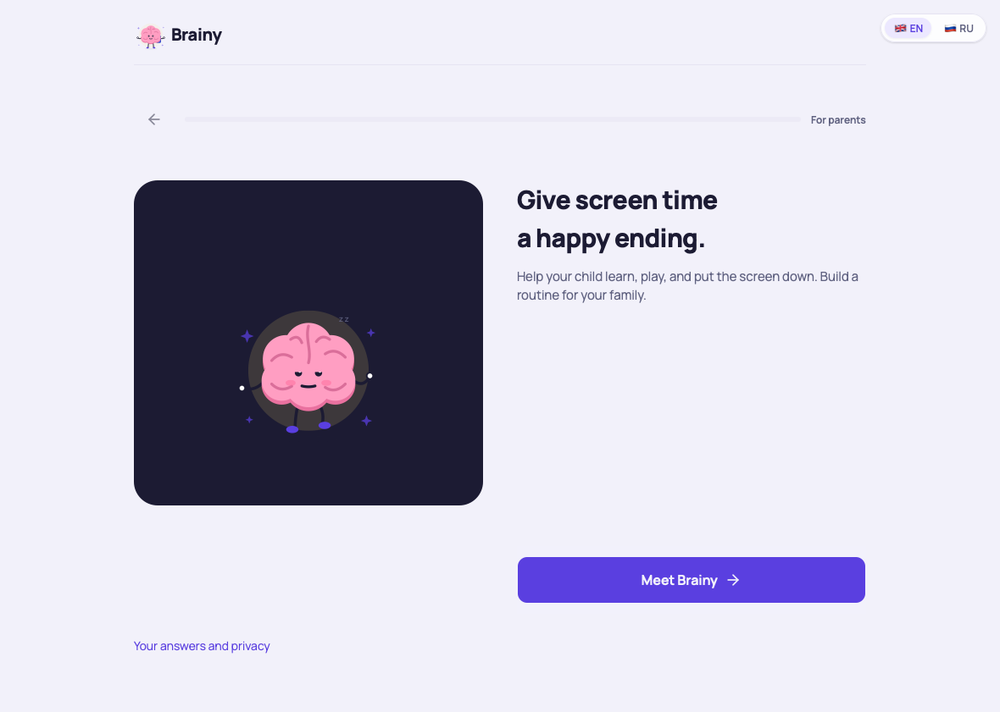
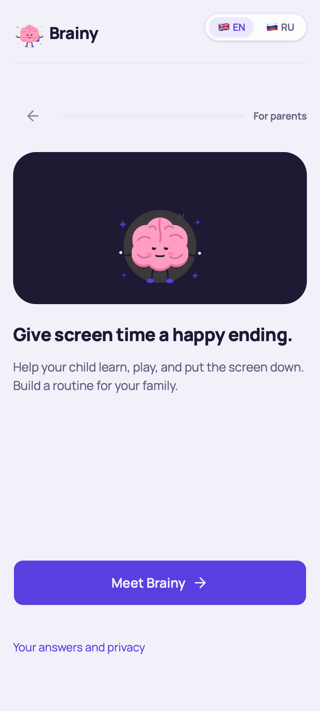
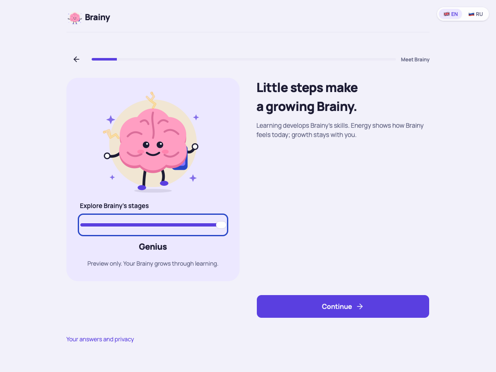
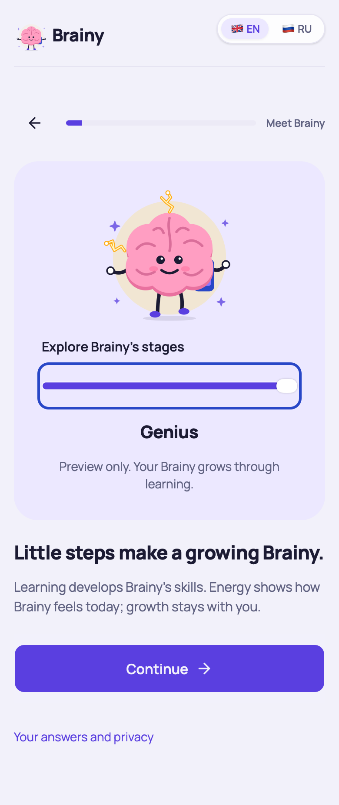
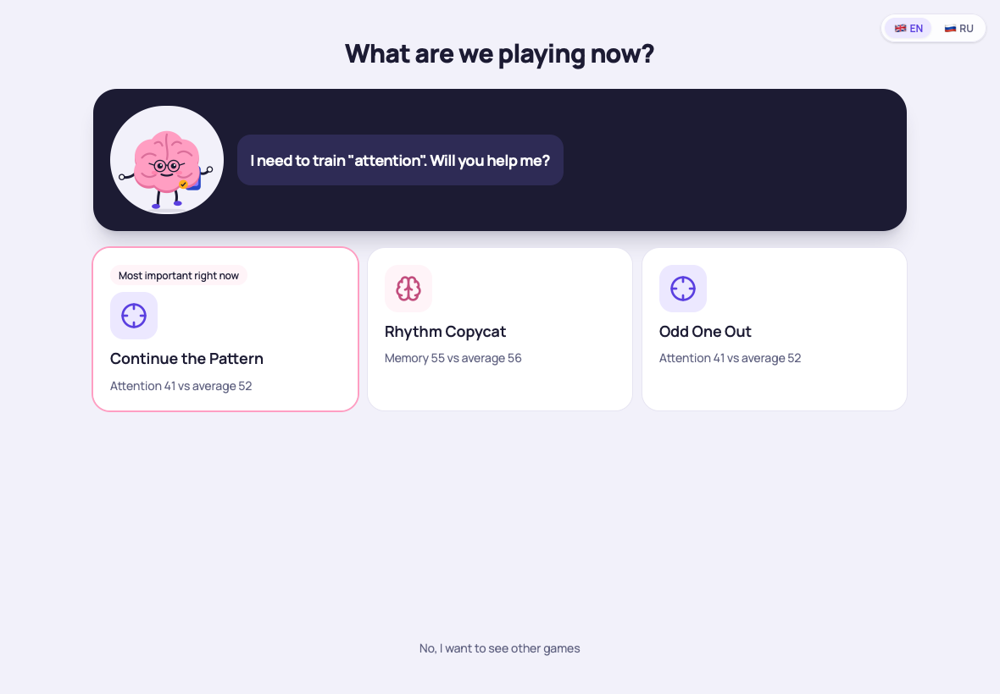
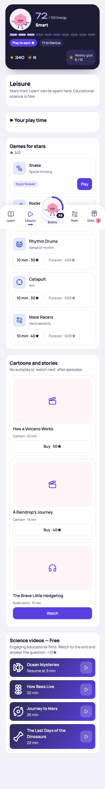
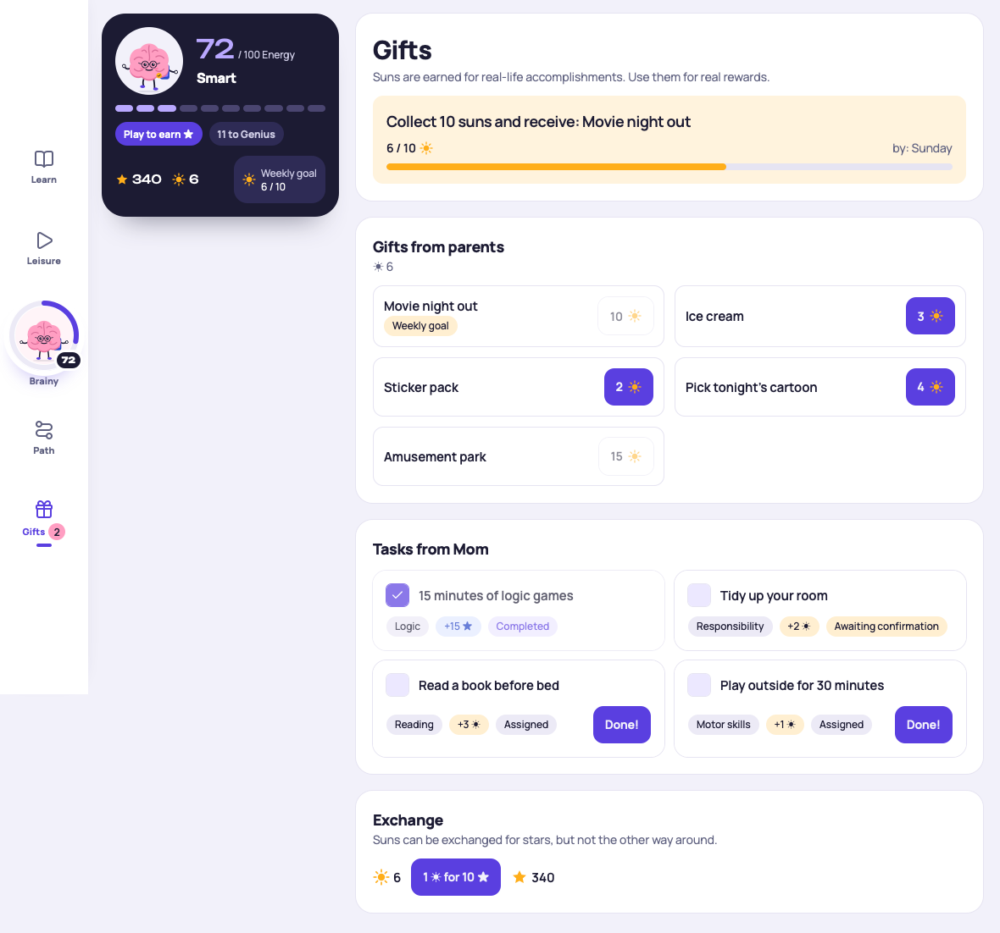
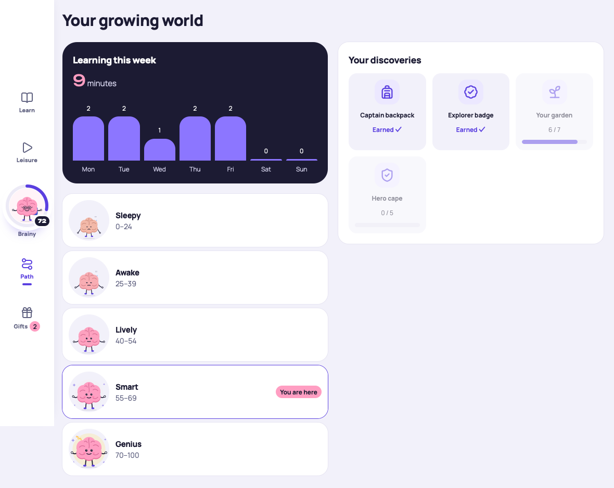
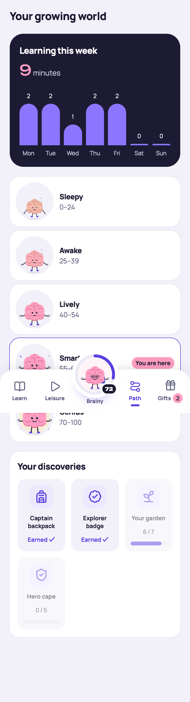

<!-- Generated by pnpm report --module mvp. Edit docs/reports/src/mvp.md. -->

# Brainee: every MVP page, child and parent

All MVP screens, recorded from a local production build with `DEMO_MODE=1` and
a freshly reset seeded database. Rewards, tasks, gifts and accessories are
saved through the demo API and sync between devices by polling. Activity analytics use saved sessions and actions; historical/character
radars and ranking remain labelled demo data. Demo parent PIN: `1234`.
[Run instructions](README.md#mvp-module).

## Recordings

Each walkthrough previews the parent funnel's cover and five real growth stages,
then opens the app on “What shall we play?”, goes to Learn,
browses Leisure, watches a science video to the end (1 s = 1 min) and answers
its quiz (a wrong answer fades, the right one pays +15 ★ once), marks a task
done and exchanges ☀ → ★ in Gifts, buys an accessory on the Brainy tab,
and visits Path for weekly learning, stages and discoveries.
Then it enters parent mode with the PIN, scrolls Analytics, confirms the
child's task in Tasks and opens Gifts & goal.

### Phone · 390 × 844

**Phone: parent preview, entry, leisure, video quiz, gifts, Brainy, Path, parent** (flow `phone-mvp`): PASSED, 30 of 30 checks passed, 61.1 s, phone. Recorded Nov 14, 2026, 4:03 p.m. (America/New_York) against `http://127.0.0.1:3123/login`.

Timeline: 90 entries

| Time | Source | Entry |
| --- | --- | --- |
| 00:00.349 | step | open /login |
| 00:01.952 | check | Demo content reset to the seed |
| 00:01.952 | step | call resetDemo |
| 00:01.952 | mark | Parent preview: cover and real growth stages |
| 00:03.507 | step | goto /start?tour=1#cover |
| 00:03.528 | check | {"by":"role","role":"heading","name":"Give screen time a happy ending.","exact":true} visible |
| 00:03.530 | check | The document language is English |
| 00:03.530 | check | The screen fits without horizontal scrolling |
| 00:03.530 | check | The two self-hosted font families load |
| 00:03.530 | step | call checkSurface |
| 00:04.732 | step | wait 1200 |
| 00:04.779 | step | click {"by":"role","role":"button","name":"Meet Brainy","exact":true} |
| 00:04.781 | check | {"by":"role","role":"heading","name":"Meet Brainy.","exact":true} visible |
| 00:04.825 | step | click {"by":"role","role":"button","name":"Continue","exact":true} |
| 00:04.827 | check | {"by":"testId","value":"funnel-growth"} visible |
| 00:04.847 | check | The funnel preview reaches the real Genius stage |
| 00:05.747 | step | call previewGrowth |
| 00:05.748 | check | The document language is English |
| 00:05.748 | check | The screen fits without horizontal scrolling |
| 00:05.748 | check | The two self-hosted font families load |
| 00:05.749 | step | call checkSurface |
| 00:07.297 | step | goto /entry |
| 00:07.316 | check | Opening the app shows the entry screen |
| 00:09.117 | step | wait 1800 |
| 00:09.117 | mark | Child: other games → Learn |
| 00:09.158 | step | click {"by":"role","role":"link","name":"No, I want to see other games","exact":true} |
| 00:09.235 | check | Learn shows Brainy's advice and the grid |
| 00:10.437 | step | wait 1200 |
| 00:10.437 | mark | Leisure: shop, cartoons, science |
| 00:10.479 | step | click {"by":"role","role":"link","name":"Leisure","exact":true} |
| 00:10.523 | check | Leisure shows the ★ shop |
| 00:10.527 | step | scroll window by 0,700 |
| 00:11.329 | step | wait 800 |
| 00:11.333 | step | scroll window by 0,900 |
| 00:12.135 | step | wait 800 |
| 00:12.135 | mark | Science video: pause-only player and quiz |
| 00:12.172 | step | click {"by":"role","role":"link","name":"How Bees Live"} |
| 00:12.961 | check | The player has only play/pause |
| 00:12.991 | step | click {"by":"role","role":"button","name":"Watch","exact":true} |
| 00:33.379 | check | The quiz appears after the last minute |
| 00:33.404 | step | click {"by":"role","role":"button","name":"Wax","exact":true} |
| 00:33.416 | network (warn) | 409 POST http://127.0.0.1:3123/api/actions |
| 00:33.416 | console (warn) | Failed to load resource: the server responded with a status of 409 (Conflict) |
| 00:34.305 | step | wait 900 |
| 00:34.320 | step | click {"by":"role","role":"button","name":"Honey","exact":true} |
| 00:34.345 | check | Correct answer pays +15★ once |
| 00:35.546 | step | wait 1200 |
| 00:35.578 | step | click {"by":"role","role":"link","name":"Back to Leisure","exact":true} |
| 00:35.578 | mark | Gifts: goal, shop, tasks, exchange |
| 00:36.395 | step | click {"by":"role","role":"link","name":"Gifts","exact":true} |
| 00:36.438 | check | Gifts shows the weekly goal and tasks |
| 00:36.442 | step | scroll window by 0,600 |
| 00:37.200 | check | Child marks a real-life task done → waits for the parent |
| 00:37.200 | step | call childTaskDone |
| 00:37.238 | step | click {"by":"role","role":"button","name":"1 ☀ for 10 ★","exact":true} |
| 00:38.240 | step | wait 1000 |
| 00:38.240 | mark | Brainy: accessory shop |
| 00:38.279 | step | click {"by":"css","value":"nav a[href=\"/brainy\"]"} |
| 00:38.316 | check | Brainy tab shows stats and the shop |
| 00:39.105 | check | Bought accessory is worn (one per slot) |
| 00:40.007 | step | call buyCheapestAccessory |
| 00:41.207 | step | wait 1200 |
| 00:41.207 | mark | Path: weekly learning, growth stages and discoveries |
| 00:41.266 | step | click {"by":"role","role":"link","name":"Path","exact":true} |
| 00:41.298 | check | Path shows the stage journey and discoveries |
| 00:41.299 | check | The document language is English |
| 00:41.299 | check | The screen fits without horizontal scrolling |
| 00:41.299 | check | The two self-hosted font families load |
| 00:41.299 | step | call checkSurface |
| 00:44.319 | step | call scrollPage |
| 00:44.319 | mark | Parent: PIN, analytics, confirm the child's task |
| 00:45.899 | step | goto /analytics |
| 00:45.920 | check | Parent mode is behind a PIN |
| 00:45.938 | step | click {"by":"role","role":"button","name":"Digit 1","exact":true} |
| 00:45.972 | step | click {"by":"role","role":"button","name":"Digit 2","exact":true} |
| 00:46.004 | step | click {"by":"role","role":"button","name":"Digit 3","exact":true} |
| 00:46.042 | step | click {"by":"role","role":"button","name":"Digit 4","exact":true} |
| 00:46.119 | check | Analytics: radars, bars, ranking |
| 00:47.121 | step | wait 1000 |
| 00:50.145 | step | call scrollPage |
| 00:50.173 | step | click {"by":"role","role":"button","name":"City","exact":true} |
| 00:50.974 | step | wait 800 |
| 00:50.988 | step | call openParentTab |
| 00:51.093 | check | Tasks: Today list with confirmations |
| 00:52.035 | check | Parent confirms → ☀ and weekly goal grow |
| 00:52.936 | step | call confirmTask |
| 00:55.967 | step | call scrollPage |
| 00:55.987 | step | call openParentTab |
| 00:56.023 | check | Gifts & goal: requests and shop |
| 00:59.054 | step | call scrollPage |

### iPad viewport · 1180 × 820 landscape

**iPad viewport: parent preview, entry, leisure, video quiz, gifts, Brainy, Path, parent** (flow `ipad-mvp`): PASSED, 30 of 30 checks passed, 61.2 s, ipad. Recorded Nov 14, 2026, 4:04 p.m. (America/New_York) against `http://127.0.0.1:3123/login`.

Timeline: 90 entries

| Time | Source | Entry |
| --- | --- | --- |
| 00:00.327 | step | open /login |
| 00:01.979 | check | Demo content reset to the seed |
| 00:01.979 | step | call resetDemo |
| 00:01.979 | mark | Parent preview: cover and real growth stages |
| 00:03.527 | step | goto /start?tour=1#cover |
| 00:03.543 | check | {"by":"role","role":"heading","name":"Give screen time a happy ending.","exact":true} visible |
| 00:03.544 | check | The document language is English |
| 00:03.544 | check | The screen fits without horizontal scrolling |
| 00:03.544 | check | The two self-hosted font families load |
| 00:03.544 | step | call checkSurface |
| 00:04.745 | step | wait 1200 |
| 00:04.780 | step | click {"by":"role","role":"button","name":"Meet Brainy","exact":true} |
| 00:04.781 | check | {"by":"role","role":"heading","name":"Meet Brainy.","exact":true} visible |
| 00:04.829 | step | click {"by":"role","role":"button","name":"Continue","exact":true} |
| 00:04.831 | check | {"by":"testId","value":"funnel-growth"} visible |
| 00:04.839 | check | The funnel preview reaches the real Genius stage |
| 00:05.740 | step | call previewGrowth |
| 00:05.741 | check | The document language is English |
| 00:05.741 | check | The screen fits without horizontal scrolling |
| 00:05.741 | check | The two self-hosted font families load |
| 00:05.741 | step | call checkSurface |
| 00:07.292 | step | goto /entry |
| 00:07.305 | check | Opening the app shows the entry screen |
| 00:09.107 | step | wait 1800 |
| 00:09.107 | mark | Child: other games → Learn |
| 00:09.149 | step | click {"by":"role","role":"link","name":"No, I want to see other games","exact":true} |
| 00:09.182 | check | Learn shows Brainy's advice and the grid |
| 00:10.384 | step | wait 1200 |
| 00:10.384 | mark | Leisure: shop, cartoons, science |
| 00:10.423 | step | click {"by":"role","role":"link","name":"Leisure","exact":true} |
| 00:10.451 | check | Leisure shows the ★ shop |
| 00:10.452 | step | scroll window by 0,700 |
| 00:11.254 | step | wait 800 |
| 00:11.255 | step | scroll window by 0,900 |
| 00:12.056 | step | wait 800 |
| 00:12.056 | mark | Science video: pause-only player and quiz |
| 00:12.090 | step | click {"by":"role","role":"link","name":"How Bees Live"} |
| 00:12.875 | check | The player has only play/pause |
| 00:12.897 | step | click {"by":"role","role":"button","name":"Watch","exact":true} |
| 00:33.325 | check | The quiz appears after the last minute |
| 00:33.356 | step | click {"by":"role","role":"button","name":"Wax","exact":true} |
| 00:33.361 | network (warn) | 409 POST http://127.0.0.1:3123/api/actions |
| 00:33.362 | console (warn) | Failed to load resource: the server responded with a status of 409 (Conflict) |
| 00:34.257 | step | wait 900 |
| 00:34.277 | step | click {"by":"role","role":"button","name":"Honey","exact":true} |
| 00:34.301 | check | Correct answer pays +15★ once |
| 00:35.503 | step | wait 1200 |
| 00:35.525 | step | click {"by":"role","role":"link","name":"Back to Leisure","exact":true} |
| 00:35.525 | mark | Gifts: goal, shop, tasks, exchange |
| 00:36.356 | step | click {"by":"role","role":"link","name":"Gifts","exact":true} |
| 00:36.386 | check | Gifts shows the weekly goal and tasks |
| 00:36.389 | step | scroll window by 0,600 |
| 00:37.100 | check | Child marks a real-life task done → waits for the parent |
| 00:37.100 | step | call childTaskDone |
| 00:37.139 | step | click {"by":"role","role":"button","name":"1 ☀ for 10 ★","exact":true} |
| 00:38.141 | step | wait 1000 |
| 00:38.141 | mark | Brainy: accessory shop |
| 00:38.176 | step | click {"by":"css","value":"nav a[href=\"/brainy\"]"} |
| 00:38.201 | check | Brainy tab shows stats and the shop |
| 00:38.992 | check | Bought accessory is worn (one per slot) |
| 00:39.893 | step | call buyCheapestAccessory |
| 00:41.095 | step | wait 1200 |
| 00:41.095 | mark | Path: weekly learning, growth stages and discoveries |
| 00:41.124 | step | click {"by":"role","role":"link","name":"Path","exact":true} |
| 00:41.148 | check | Path shows the stage journey and discoveries |
| 00:41.149 | check | The document language is English |
| 00:41.149 | check | The screen fits without horizontal scrolling |
| 00:41.149 | check | The two self-hosted font families load |
| 00:41.149 | step | call checkSurface |
| 00:44.161 | step | call scrollPage |
| 00:44.161 | mark | Parent: PIN, analytics, confirm the child's task |
| 00:45.750 | step | goto /analytics |
| 00:45.777 | check | Parent mode is behind a PIN |
| 00:45.807 | step | click {"by":"role","role":"button","name":"Digit 1","exact":true} |
| 00:45.850 | step | click {"by":"role","role":"button","name":"Digit 2","exact":true} |
| 00:45.899 | step | click {"by":"role","role":"button","name":"Digit 3","exact":true} |
| 00:45.923 | step | click {"by":"role","role":"button","name":"Digit 4","exact":true} |
| 00:45.999 | check | Analytics: radars, bars, ranking |
| 00:47.000 | step | wait 1000 |
| 00:50.012 | step | call scrollPage |
| 00:50.042 | step | click {"by":"role","role":"button","name":"City","exact":true} |
| 00:50.843 | step | wait 800 |
| 00:50.855 | step | call openParentTab |
| 00:50.959 | check | Tasks: Today list with confirmations |
| 00:51.244 | check | Parent confirms → ☀ and weekly goal grow |
| 00:52.146 | step | call confirmTask |
| 00:55.171 | step | call scrollPage |
| 00:55.189 | step | call openParentTab |
| 00:55.217 | check | Gifts & goal: requests and shop |
| 00:58.238 | step | call scrollPage |

## Parent funnel preview

The review session is separate from normal saved answers. These preview stages
create no game session or reward; signup and plan persistence are separate flows.

### Cover

| iPad (1180 × 820 landscape) | Phone (390 × 844) |
| --- | --- |
|  |  |
| _start-cover_ | _start-cover_ |

### Growth slider · Genius preview

| iPad (1180 × 820 landscape) | Phone (390 × 844) |
| --- | --- |
|  |  |
| _start-growth_ | _start-growth_ |

## Child screens

### Entry “What shall we play?”

| iPad (1180 × 820 landscape) | Phone (390 × 844) |
| --- | --- |
|  |  |
| _entry_ | _entry_ |

### Learn

| iPad (1180 × 820 landscape) | Phone (390 × 844) |
| --- | --- |
|  |  |
| _learn_ | _learn_ |

### Leisure

| iPad (1180 × 820 landscape) | Phone (390 × 844) |
| --- | --- |
|  |  |
| _leisure_ | _leisure_ |

### Science video player

| iPad (1180 × 820 landscape) | Phone (390 × 844) |
| --- | --- |
|  |  |
| _video_ | _video_ |

### Gifts

| iPad (1180 × 820 landscape) | Phone (390 × 844) |
| --- | --- |
|  |  |
| _gifts_ | _gifts_ |

### Brainy

| iPad (1180 × 820 landscape) | Phone (390 × 844) |
| --- | --- |
|  |  |
| _brainy_ | _brainy_ |

### Path

| iPad (1180 × 820 landscape) | Phone (390 × 844) |
| --- | --- |
|  |  |
| _path_ | _path_ |

## Parent screens

### PIN barrier

| iPad (1180 × 820 landscape) | Phone (390 × 844) |
| --- | --- |
|  |  |
| _parent-pin_ | _parent-pin_ |

### Analytics

| iPad (1180 × 820 landscape) | Phone (390 × 844) |
| --- | --- |
|  |  |
| _analytics_ | _analytics_ |

### Tasks

| iPad (1180 × 820 landscape) | Phone (390 × 844) |
| --- | --- |
|  |  |
| _tasks_ | _tasks_ |

### Gifts & goal

| iPad (1180 × 820 landscape) | Phone (390 × 844) |
| --- | --- |
|  |  |
| _rewards_ | _rewards_ |

## Logs and capture checks

[Download the flow timelines (JSON)](logs/mvp.json).

Captured Nov 14, 2026, 4:03 p.m. (America/New_York): 26 scenarios, ipad and phone; English, light theme. No failed steps, redirects, JavaScript errors, HTTP errors or unexpected failed requests. 0 known lifecycle request cancellations remain in the manifest. Source: `91572fa`. Imported static references are not live captures. Flows: `phone-mvp` PASSED (30 checks), `ipad-mvp` PASSED (30 checks). Timelines: [JSON log](logs/mvp.json).

The editable [template](src/mvp.md), [scenario](../../scripts/reports/scenarios/mvp.json)
and [walkthrough actions](../../scripts/reports/scenarios/mvp.mjs) define what
this report captures. Recorded in WebKit with English UI and New York time; `pnpm e2e` covers Chromium and WebKit.
