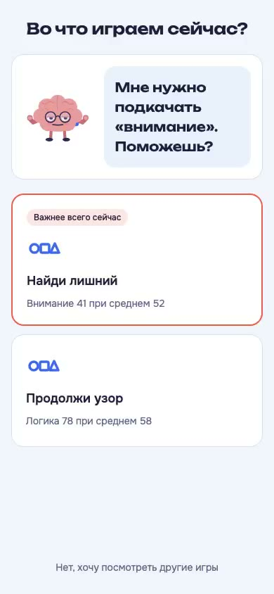

<!-- Generated by pnpm report --module mvp. Edit docs/reports/src/mvp.md. -->

# Brainee: every MVP page, child and parent

All MVP screens, recorded from a local production build with `DEMO_MODE=1` and
a freshly reset seeded database. Rewards, tasks, gifts and accessories are
saved through the demo API and sync between devices by polling. **Analytics
numbers are seeded demo data (D-21)**, not calculated. Demo parent PIN: `1234`.
[Run instructions](README.md#mvp-module).

## Recordings

Each walkthrough opens the app on «Во что играем сейчас?», goes to Learn,
browses Leisure, watches a science video to the end (1 s = 1 min) and answers
its quiz (a wrong answer fades, the right one pays +15 ★ once), marks a task
done and exchanges ☀ → ★ in Gifts, and buys an accessory on the Brainy tab.
Then it enters parent mode with the PIN, scrolls Analytics, confirms the
child's task in Tasks and opens Gifts & goal.

### Phone · 390 × 844

**Phone: entry, leisure, video quiz, gifts, Brainy shop, parent** (flow `phone-mvp`): PASSED, 16 of 16 checks passed, 52.7 s, phone. Recorded Nov 14, 2026, 7:08 p.m. (Asia/Almaty) against `http://127.0.0.1:3123/login`.

Timeline: 64 entries

| Time | Source | Entry |
| --- | --- | --- |
| 00:00.059 | step | open /login |
| 00:01.613 | check | Demo content reset to the seed |
| 00:01.613 | step | call resetDemo |
| 00:03.146 | step | goto / |
| 00:03.170 | check | Opening the app shows the entry screen |
| 00:04.971 | step | wait 1800 |
| 00:04.971 | mark | Child: other games → Learn |
| 00:04.999 | step | click {"by":"role","role":"link","name":"Нет, хочу посмотреть другие игры","exact":true} |
| 00:05.048 | check | Learn shows Brainy's advice and the grid |
| 00:06.251 | step | wait 1200 |
| 00:06.251 | mark | Leisure: shop, cartoons, science |
| 00:06.259 | step | click {"by":"role","role":"link","name":"Отдых","exact":true} |
| 00:06.333 | check | Leisure shows the ★ shop |
| 00:06.333 | step | scroll window by 0,700 |
| 00:07.135 | step | wait 800 |
| 00:07.145 | step | scroll window by 0,900 |
| 00:07.949 | step | wait 800 |
| 00:07.949 | mark | Science video: pause-only player and quiz |
| 00:07.982 | step | click {"by":"role","role":"link","name":"Как живут пчёлы"} |
| 00:08.007 | check | The player has only play/pause |
| 00:08.043 | step | click {"by":"role","role":"button","name":"Смотреть","exact":true} |
| 00:28.383 | check | The quiz appears after the last minute |
| 00:28.410 | step | click {"by":"role","role":"button","name":"Воск","exact":true} |
| 00:28.423 | network (warn) | 409 POST http://127.0.0.1:3123/api/actions |
| 00:28.424 | console (warn) | Failed to load resource: the server responded with a status of 409 (Conflict) |
| 00:29.311 | step | wait 900 |
| 00:29.325 | step | click {"by":"role","role":"button","name":"Мёд","exact":true} |
| 00:29.349 | check | Correct answer pays +15★ once |
| 00:30.551 | step | wait 1200 |
| 00:30.576 | step | click {"by":"role","role":"link","name":"Вернуться в «Отдых»","exact":true} |
| 00:30.576 | mark | Gifts: goal, shop, tasks, exchange |
| 00:30.624 | step | click {"by":"role","role":"link","name":"Подарки","exact":true} |
| 00:30.699 | check | Gifts shows the weekly goal and tasks |
| 00:30.700 | step | scroll window by 0,600 |
| 00:31.364 | check | Child marks a real-life task done → waits for the parent |
| 00:31.364 | step | call childTaskDone |
| 00:31.392 | step | click {"by":"role","role":"button","name":"1 ☀ на 10 ★","exact":true} |
| 00:32.393 | step | wait 1000 |
| 00:32.393 | mark | Brainy: accessory shop |
| 00:32.409 | step | click {"by":"role","role":"link","name":"Брейни","exact":true} |
| 00:32.484 | check | Brainy tab shows stats and the shop |
| 00:33.239 | check | Bought accessory is worn (one per slot) |
| 00:34.807 | step | call buyCheapestAccessory |
| 00:36.007 | step | wait 1200 |
| 00:36.007 | mark | Parent: PIN, analytics, confirm the child's task |
| 00:37.549 | step | goto /analytics |
| 00:37.572 | check | Parent mode is behind a PIN |
| 00:37.595 | step | click {"by":"role","role":"button","name":"Цифра 1","exact":true} |
| 00:37.626 | step | click {"by":"role","role":"button","name":"Цифра 2","exact":true} |
| 00:37.660 | step | click {"by":"role","role":"button","name":"Цифра 3","exact":true} |
| 00:37.694 | step | click {"by":"role","role":"button","name":"Цифра 4","exact":true} |
| 00:37.768 | check | Analytics: radars, bars, ranking |
| 00:38.769 | step | wait 1000 |
| 00:41.784 | step | call scrollPage |
| 00:41.812 | step | click {"by":"role","role":"button","name":"Город","exact":true} |
| 00:42.614 | step | wait 800 |
| 00:42.626 | step | call openParentTab |
| 00:42.702 | check | Tasks: Today list with confirmations |
| 00:43.616 | check | Parent confirms → ☀ and weekly goal grow |
| 00:44.518 | step | call confirmTask |
| 00:47.545 | step | call scrollPage |
| 00:47.559 | step | call openParentTab |
| 00:47.634 | check | Gifts & goal: requests and shop |
| 00:50.666 | step | call scrollPage |

### iPad viewport · 1180 × 820 landscape

**iPad viewport: entry, leisure, video quiz, gifts, Brainy shop, parent** (flow `ipad-mvp`): PASSED, 16 of 16 checks passed, 52.5 s, ipad. Recorded Nov 14, 2026, 7:09 p.m. (Asia/Almaty) against `http://127.0.0.1:3123/login`.

Timeline: 64 entries

| Time | Source | Entry |
| --- | --- | --- |
| 00:00.060 | step | open /login |
| 00:01.632 | check | Demo content reset to the seed |
| 00:01.632 | step | call resetDemo |
| 00:03.168 | step | goto / |
| 00:03.182 | check | Opening the app shows the entry screen |
| 00:04.983 | step | wait 1800 |
| 00:04.983 | mark | Child: other games → Learn |
| 00:05.026 | step | click {"by":"role","role":"link","name":"Нет, хочу посмотреть другие игры","exact":true} |
| 00:05.040 | check | Learn shows Brainy's advice and the grid |
| 00:06.242 | step | wait 1200 |
| 00:06.242 | mark | Leisure: shop, cartoons, science |
| 00:06.263 | step | click {"by":"role","role":"link","name":"Отдых","exact":true} |
| 00:06.341 | check | Leisure shows the ★ shop |
| 00:06.342 | step | scroll window by 0,700 |
| 00:07.144 | step | wait 800 |
| 00:07.147 | step | scroll window by 0,900 |
| 00:07.948 | step | wait 800 |
| 00:07.948 | mark | Science video: pause-only player and quiz |
| 00:07.968 | step | click {"by":"role","role":"link","name":"Как живут пчёлы"} |
| 00:07.994 | check | The player has only play/pause |
| 00:08.030 | step | click {"by":"role","role":"button","name":"Смотреть","exact":true} |
| 00:28.364 | check | The quiz appears after the last minute |
| 00:28.395 | step | click {"by":"role","role":"button","name":"Воск","exact":true} |
| 00:28.410 | network (warn) | 409 POST http://127.0.0.1:3123/api/actions |
| 00:28.410 | console (warn) | Failed to load resource: the server responded with a status of 409 (Conflict) |
| 00:29.297 | step | wait 900 |
| 00:29.319 | step | click {"by":"role","role":"button","name":"Мёд","exact":true} |
| 00:29.344 | check | Correct answer pays +15★ once |
| 00:30.546 | step | wait 1200 |
| 00:30.566 | step | click {"by":"role","role":"link","name":"Вернуться в «Отдых»","exact":true} |
| 00:30.566 | mark | Gifts: goal, shop, tasks, exchange |
| 00:30.611 | step | click {"by":"role","role":"link","name":"Подарки","exact":true} |
| 00:30.686 | check | Gifts shows the weekly goal and tasks |
| 00:30.687 | step | scroll window by 0,600 |
| 00:31.363 | check | Child marks a real-life task done → waits for the parent |
| 00:31.363 | step | call childTaskDone |
| 00:31.395 | step | click {"by":"role","role":"button","name":"1 ☀ на 10 ★","exact":true} |
| 00:32.397 | step | wait 1000 |
| 00:32.397 | mark | Brainy: accessory shop |
| 00:32.413 | step | click {"by":"role","role":"link","name":"Брейни","exact":true} |
| 00:32.490 | check | Brainy tab shows stats and the shop |
| 00:33.231 | check | Bought accessory is worn (one per slot) |
| 00:34.145 | step | call buyCheapestAccessory |
| 00:35.347 | step | wait 1200 |
| 00:35.347 | mark | Parent: PIN, analytics, confirm the child's task |
| 00:36.903 | step | goto /analytics |
| 00:36.929 | check | Parent mode is behind a PIN |
| 00:36.944 | step | click {"by":"role","role":"button","name":"Цифра 1","exact":true} |
| 00:36.976 | step | click {"by":"role","role":"button","name":"Цифра 2","exact":true} |
| 00:37.009 | step | click {"by":"role","role":"button","name":"Цифра 3","exact":true} |
| 00:37.043 | step | click {"by":"role","role":"button","name":"Цифра 4","exact":true} |
| 00:37.118 | check | Analytics: radars, bars, ranking |
| 00:38.119 | step | wait 1000 |
| 00:41.139 | step | call scrollPage |
| 00:41.164 | step | click {"by":"role","role":"button","name":"Город","exact":true} |
| 00:41.965 | step | wait 800 |
| 00:41.994 | step | call openParentTab |
| 00:42.072 | check | Tasks: Today list with confirmations |
| 00:42.351 | check | Parent confirms → ☀ and weekly goal grow |
| 00:43.253 | step | call confirmTask |
| 00:46.266 | step | call scrollPage |
| 00:46.292 | step | call openParentTab |
| 00:46.370 | check | Gifts & goal: requests and shop |
| 00:49.393 | step | call scrollPage |

## Child screens

### Entry «Во что играем сейчас?»

| iPad (1180 × 820 landscape) | Phone (390 × 844) |
| --- | --- |
|  |  |
| _entry_ | _entry_ |

### Learn

| iPad (1180 × 820 landscape) | Phone (390 × 844) |
| --- | --- |
|  |  |
| _learn_ | _learn_ |

### Leisure

| iPad (1180 × 820 landscape) | Phone (390 × 844) |
| --- | --- |
|  |  |
| _leisure_ | _leisure_ |

### Science video player

| iPad (1180 × 820 landscape) | Phone (390 × 844) |
| --- | --- |
|  |  |
| _video_ | _video_ |

### Gifts

| iPad (1180 × 820 landscape) | Phone (390 × 844) |
| --- | --- |
|  |  |
| _gifts_ | _gifts_ |

### Brainy

| iPad (1180 × 820 landscape) | Phone (390 × 844) |
| --- | --- |
|  |  |
| _brainy_ | _brainy_ |

## Parent screens

### PIN barrier

| iPad (1180 × 820 landscape) | Phone (390 × 844) |
| --- | --- |
|  |  |
| _parent-pin_ | _parent-pin_ |

### Analytics

| iPad (1180 × 820 landscape) | Phone (390 × 844) |
| --- | --- |
|  |  |
| _analytics_ | _analytics_ |

### Tasks

| iPad (1180 × 820 landscape) | Phone (390 × 844) |
| --- | --- |
|  |  |
| _tasks_ | _tasks_ |

### Gifts & goal

| iPad (1180 × 820 landscape) | Phone (390 × 844) |
| --- | --- |
|  |  |
| _rewards_ | _rewards_ |

## Logs and capture checks

[Download the flow timelines (JSON)](logs/mvp.json).

Captured Nov 14, 2026, 7:08 p.m. (Asia/Almaty): 20 scenarios, ipad and phone; Russian, light theme. No failed steps, redirects, JavaScript errors, HTTP errors or unexpected failed requests. 0 known lifecycle request cancellations remain in the manifest. Source: `3a39c69` with working-tree changes. Imported static references are not live captures. Flows: `phone-mvp` PASSED (16 checks), `ipad-mvp` PASSED (16 checks). Timelines: [JSON log](logs/mvp.json).

The editable [template](src/mvp.md), [scenario](../../scripts/reports/scenarios/mvp.json)
and [walkthrough actions](../../scripts/reports/scenarios/mvp.mjs) define what
this report captures. Recorded in Chromium; `pnpm e2e` covers Chromium and WebKit.
