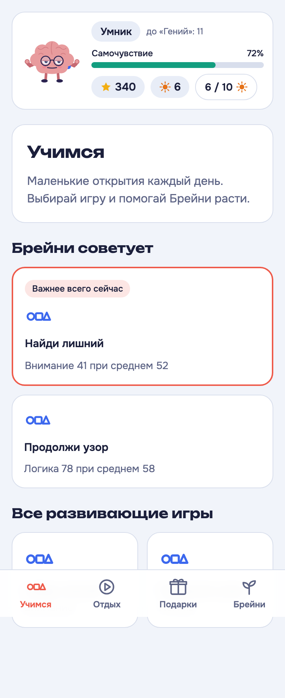
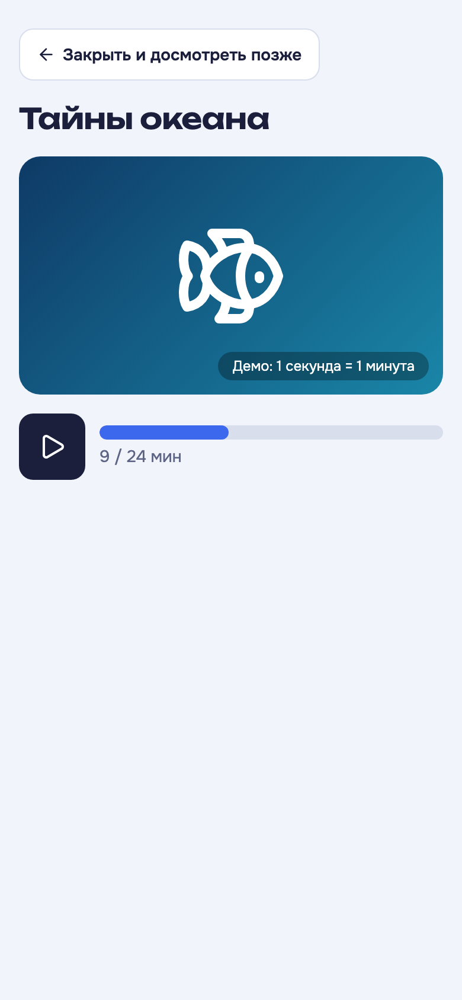
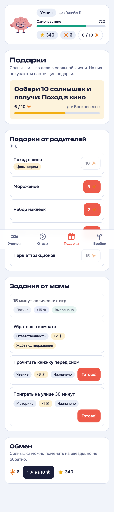
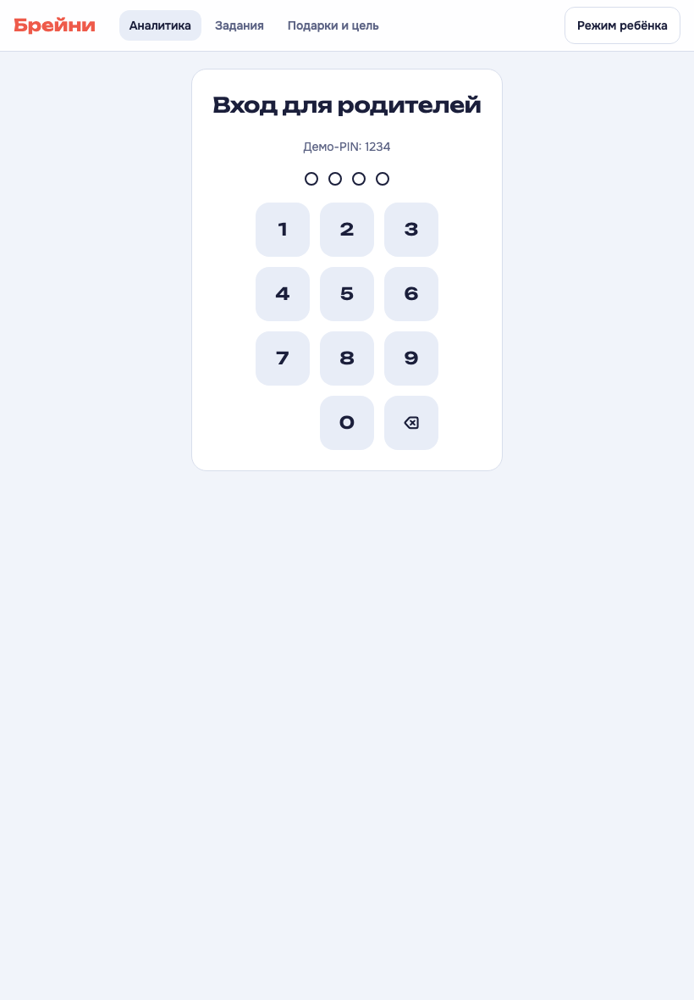
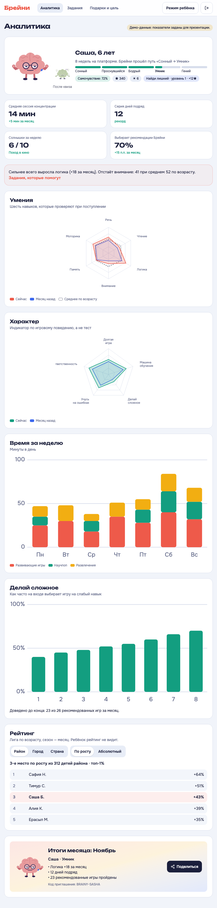
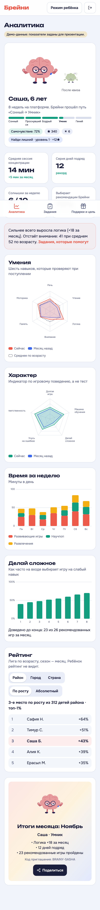
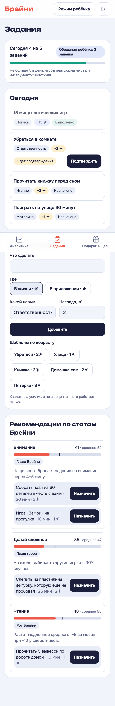

<!-- Generated by pnpm report --module mvp. Edit docs/reports/src/mvp.md. -->

# Brainee: every MVP page, child and parent

All MVP screens, recorded from a local production build with `DEMO_MODE=1` and
a freshly reset seeded database. Rewards, tasks, gifts and accessories are
saved through the demo API and sync between devices by polling. **Analytics
numbers are seeded demo data (D-21)**, not calculated. Demo parent PIN: `1234`.
[Run instructions](README.md#mvp-module).

## Recordings

Each walkthrough opens the app on «Во что играем сейчас?», goes to Learn,
browses Leisure, watches a science video to the end (1 s = 1 min) and answers
its quiz (a wrong answer fades, the right one pays +15 ★ once), marks a task
done and exchanges ☀ → ★ in Gifts, and buys an accessory on the Brainy tab.
Then it enters parent mode with the PIN, scrolls Analytics, confirms the
child's task in Tasks and opens Gifts & goal.

### Phone · 390 × 844

**Phone: entry, leisure, video quiz, gifts, Brainy shop, parent** (flow `phone-mvp`): PASSED, 16 of 16 checks passed, 52.8 s, phone. Recorded Nov 14, 2026, 5:58 p.m. (Asia/Almaty) against `http://127.0.0.1:3123/login`.

Timeline: 64 entries

| Time | Source | Entry |
| --- | --- | --- |
| 00:00.053 | step | open /login |
| 00:01.623 | check | Demo content reset to the seed |
| 00:01.623 | step | call resetDemo |
| 00:03.161 | step | goto / |
| 00:03.183 | check | Opening the app shows the entry screen |
| 00:04.985 | step | wait 1800 |
| 00:04.985 | mark | Child: other games → Learn |
| 00:05.033 | step | click {"by":"role","role":"link","name":"Нет, хочу посмотреть другие игры","exact":true} |
| 00:05.035 | check | Learn shows Brainy's advice and the grid |
| 00:06.237 | step | wait 1200 |
| 00:06.237 | mark | Leisure: shop, cartoons, science |
| 00:06.260 | step | click {"by":"role","role":"link","name":"Отдых","exact":true} |
| 00:06.336 | check | Leisure shows the ★ shop |
| 00:06.337 | step | scroll window by 0,700 |
| 00:07.139 | step | wait 800 |
| 00:07.147 | step | scroll window by 0,900 |
| 00:07.951 | step | wait 800 |
| 00:07.951 | mark | Science video: pause-only player and quiz |
| 00:07.984 | step | click {"by":"role","role":"link","name":"Как живут пчёлы"} |
| 00:08.009 | check | The player has only play/pause |
| 00:08.041 | step | click {"by":"role","role":"button","name":"Смотреть","exact":true} |
| 00:28.377 | check | The quiz appears after the last minute |
| 00:28.408 | step | click {"by":"role","role":"button","name":"Воск","exact":true} |
| 00:28.421 | network (warn) | 409 POST http://127.0.0.1:3123/api/actions |
| 00:28.422 | console (warn) | Failed to load resource: the server responded with a status of 409 (Conflict) |
| 00:29.310 | step | wait 900 |
| 00:29.331 | step | click {"by":"role","role":"button","name":"Мёд","exact":true} |
| 00:29.357 | check | Correct answer pays +15★ once |
| 00:30.558 | step | wait 1200 |
| 00:30.574 | step | click {"by":"role","role":"link","name":"Вернуться в «Отдых»","exact":true} |
| 00:30.575 | mark | Gifts: goal, shop, tasks, exchange |
| 00:30.623 | step | click {"by":"role","role":"link","name":"Подарки","exact":true} |
| 00:30.696 | check | Gifts shows the weekly goal and tasks |
| 00:30.697 | step | scroll window by 0,600 |
| 00:31.372 | check | Child marks a real-life task done → waits for the parent |
| 00:31.372 | step | call childTaskDone |
| 00:31.407 | step | click {"by":"role","role":"button","name":"1 ☀ на 10 ★","exact":true} |
| 00:32.409 | step | wait 1000 |
| 00:32.409 | mark | Brainy: accessory shop |
| 00:32.423 | step | click {"by":"role","role":"link","name":"Брейни","exact":true} |
| 00:32.499 | check | Brainy tab shows stats and the shop |
| 00:33.244 | check | Bought accessory is worn (one per slot) |
| 00:34.805 | step | call buyCheapestAccessory |
| 00:36.007 | step | wait 1200 |
| 00:36.007 | mark | Parent: PIN, analytics, confirm the child's task |
| 00:37.554 | step | goto /analytics |
| 00:37.570 | check | Parent mode is behind a PIN |
| 00:37.578 | step | click {"by":"role","role":"button","name":"Цифра 1","exact":true} |
| 00:37.612 | step | click {"by":"role","role":"button","name":"Цифра 2","exact":true} |
| 00:37.646 | step | click {"by":"role","role":"button","name":"Цифра 3","exact":true} |
| 00:37.678 | step | click {"by":"role","role":"button","name":"Цифра 4","exact":true} |
| 00:37.753 | check | Analytics: radars, bars, ranking |
| 00:38.754 | step | wait 1000 |
| 00:41.782 | step | call scrollPage |
| 00:41.823 | step | click {"by":"role","role":"button","name":"Город","exact":true} |
| 00:42.626 | step | wait 800 |
| 00:42.646 | step | call openParentTab |
| 00:42.722 | check | Tasks: Today list with confirmations |
| 00:43.654 | check | Parent confirms → ☀ and weekly goal grow |
| 00:44.555 | step | call confirmTask |
| 00:47.579 | step | call scrollPage |
| 00:47.617 | step | call openParentTab |
| 00:47.696 | check | Gifts & goal: requests and shop |
| 00:50.727 | step | call scrollPage |

### iPad viewport · 820 × 1180

**iPad viewport: entry, leisure, video quiz, gifts, Brainy shop, parent** (flow `ipad-mvp`): PASSED, 16 of 16 checks passed, 53.5 s, ipad. Recorded Nov 14, 2026, 5:59 p.m. (Asia/Almaty) against `http://127.0.0.1:3123/login`.

Timeline: 64 entries

| Time | Source | Entry |
| --- | --- | --- |
| 00:00.063 | step | open /login |
| 00:01.624 | check | Demo content reset to the seed |
| 00:01.624 | step | call resetDemo |
| 00:03.160 | step | goto / |
| 00:03.181 | check | Opening the app shows the entry screen |
| 00:04.982 | step | wait 1800 |
| 00:04.982 | mark | Child: other games → Learn |
| 00:05.007 | step | click {"by":"role","role":"link","name":"Нет, хочу посмотреть другие игры","exact":true} |
| 00:05.030 | check | Learn shows Brainy's advice and the grid |
| 00:06.231 | step | wait 1200 |
| 00:06.231 | mark | Leisure: shop, cartoons, science |
| 00:06.261 | step | click {"by":"role","role":"link","name":"Отдых","exact":true} |
| 00:06.337 | check | Leisure shows the ★ shop |
| 00:06.338 | step | scroll window by 0,700 |
| 00:07.139 | step | wait 800 |
| 00:07.141 | step | scroll window by 0,900 |
| 00:07.943 | step | wait 800 |
| 00:07.943 | mark | Science video: pause-only player and quiz |
| 00:07.979 | step | click {"by":"role","role":"link","name":"Как живут пчёлы"} |
| 00:08.005 | check | The player has only play/pause |
| 00:08.038 | step | click {"by":"role","role":"button","name":"Смотреть","exact":true} |
| 00:28.362 | check | The quiz appears after the last minute |
| 00:28.387 | step | click {"by":"role","role":"button","name":"Воск","exact":true} |
| 00:28.402 | network (warn) | 409 POST http://127.0.0.1:3123/api/actions |
| 00:28.402 | console (warn) | Failed to load resource: the server responded with a status of 409 (Conflict) |
| 00:29.290 | step | wait 900 |
| 00:29.309 | step | click {"by":"role","role":"button","name":"Мёд","exact":true} |
| 00:29.334 | check | Correct answer pays +15★ once |
| 00:30.535 | step | wait 1200 |
| 00:30.560 | step | click {"by":"role","role":"link","name":"Вернуться в «Отдых»","exact":true} |
| 00:30.560 | mark | Gifts: goal, shop, tasks, exchange |
| 00:30.620 | step | click {"by":"role","role":"link","name":"Подарки","exact":true} |
| 00:30.697 | check | Gifts shows the weekly goal and tasks |
| 00:30.698 | step | scroll window by 0,600 |
| 00:31.386 | check | Child marks a real-life task done → waits for the parent |
| 00:31.386 | step | call childTaskDone |
| 00:31.421 | step | click {"by":"role","role":"button","name":"1 ☀ на 10 ★","exact":true} |
| 00:32.423 | step | wait 1000 |
| 00:32.423 | mark | Brainy: accessory shop |
| 00:32.459 | step | click {"by":"role","role":"link","name":"Брейни","exact":true} |
| 00:32.537 | check | Brainy tab shows stats and the shop |
| 00:33.289 | check | Bought accessory is worn (one per slot) |
| 00:34.653 | step | call buyCheapestAccessory |
| 00:35.854 | step | wait 1200 |
| 00:35.854 | mark | Parent: PIN, analytics, confirm the child's task |
| 00:37.387 | step | goto /analytics |
| 00:37.406 | check | Parent mode is behind a PIN |
| 00:37.416 | step | click {"by":"role","role":"button","name":"Цифра 1","exact":true} |
| 00:37.449 | step | click {"by":"role","role":"button","name":"Цифра 2","exact":true} |
| 00:37.482 | step | click {"by":"role","role":"button","name":"Цифра 3","exact":true} |
| 00:37.517 | step | click {"by":"role","role":"button","name":"Цифра 4","exact":true} |
| 00:37.591 | check | Analytics: radars, bars, ranking |
| 00:38.593 | step | wait 1000 |
| 00:41.610 | step | call scrollPage |
| 00:41.634 | step | click {"by":"role","role":"button","name":"Город","exact":true} |
| 00:42.437 | step | wait 800 |
| 00:42.467 | step | call openParentTab |
| 00:42.544 | check | Tasks: Today list with confirmations |
| 00:43.474 | check | Parent confirms → ☀ and weekly goal grow |
| 00:44.377 | step | call confirmTask |
| 00:47.403 | step | call scrollPage |
| 00:47.417 | step | call openParentTab |
| 00:47.495 | check | Gifts & goal: requests and shop |
| 00:50.529 | step | call scrollPage |

## Child screens

### Entry «Во что играем сейчас?»

| iPad (820 × 1180) | Phone (390 × 844) |
| --- | --- |
|  |  |
| _entry_ | _entry_ |

### Learn

| iPad (820 × 1180) | Phone (390 × 844) |
| --- | --- |
|  |  |
| _learn_ | _learn_ |

### Leisure

| iPad (820 × 1180) | Phone (390 × 844) |
| --- | --- |
|  |  |
| _leisure_ | _leisure_ |

### Science video player

| iPad (820 × 1180) | Phone (390 × 844) |
| --- | --- |
|  |  |
| _video_ | _video_ |

### Gifts

| iPad (820 × 1180) | Phone (390 × 844) |
| --- | --- |
|  |  |
| _gifts_ | _gifts_ |

### Brainy

| iPad (820 × 1180) | Phone (390 × 844) |
| --- | --- |
|  |  |
| _brainy_ | _brainy_ |

## Parent screens

### PIN barrier

| iPad (820 × 1180) | Phone (390 × 844) |
| --- | --- |
|  |  |
| _parent-pin_ | _parent-pin_ |

### Analytics

| iPad (820 × 1180) | Phone (390 × 844) |
| --- | --- |
|  |  |
| _analytics_ | _analytics_ |

### Tasks

| iPad (820 × 1180) | Phone (390 × 844) |
| --- | --- |
|  |  |
| _tasks_ | _tasks_ |

### Gifts & goal

| iPad (820 × 1180) | Phone (390 × 844) |
| --- | --- |
|  |  |
| _rewards_ | _rewards_ |

## Logs and capture checks

[Download the flow timelines (JSON)](logs/mvp.json).

Captured Nov 14, 2026, 5:58 p.m. (Asia/Almaty): 20 scenarios, ipad and phone; Russian, light theme. No failed steps, redirects, JavaScript errors, HTTP errors or unexpected failed requests. 0 known lifecycle request cancellations remain in the manifest. Source: `09a7732` with working-tree changes. Imported static references are not live captures. Flows: `phone-mvp` PASSED (16 checks), `ipad-mvp` PASSED (16 checks). Timelines: [JSON log](logs/mvp.json).

The editable [template](src/mvp.md), [scenario](../../scripts/reports/scenarios/mvp.json)
and [walkthrough actions](../../scripts/reports/scenarios/mvp.mjs) define what
this report captures. Recorded in Chromium; `pnpm e2e` covers Chromium and WebKit.
