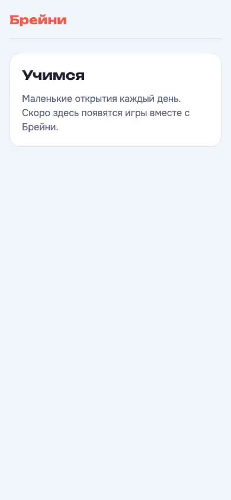
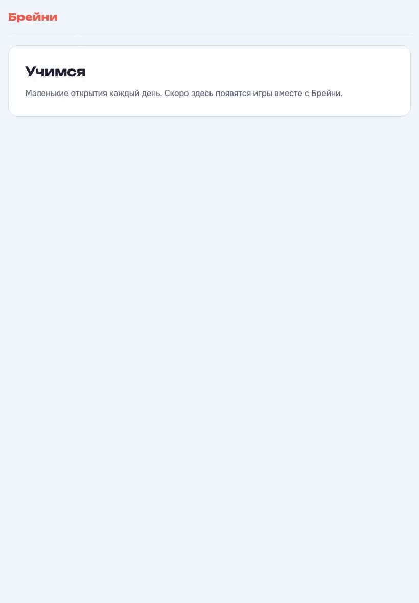
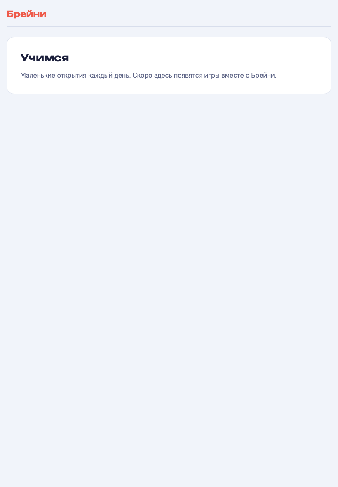
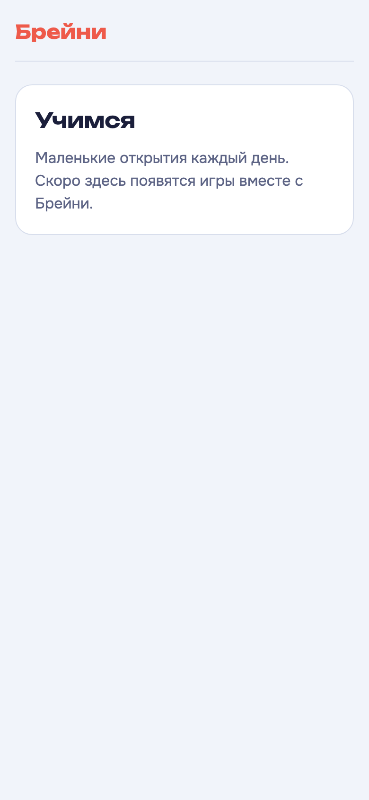
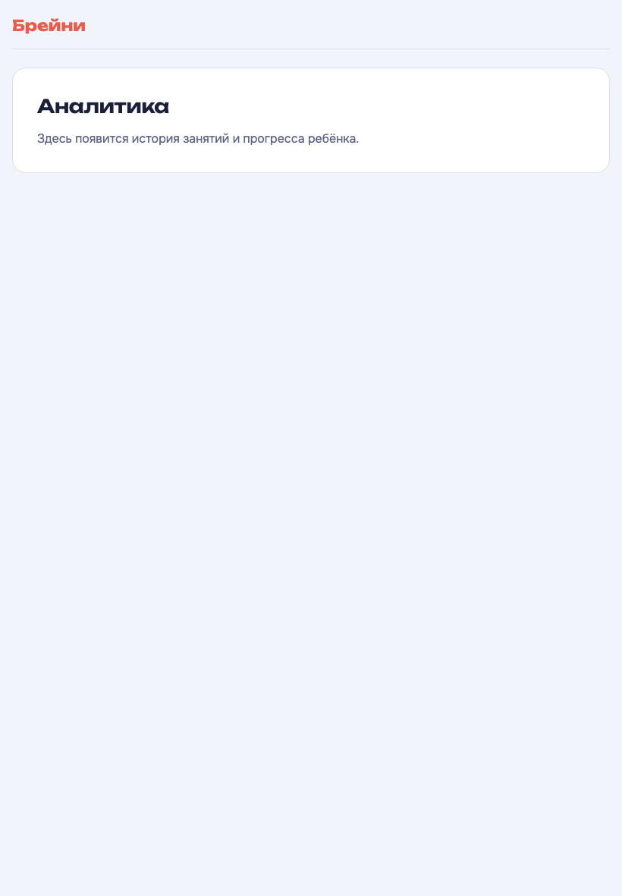
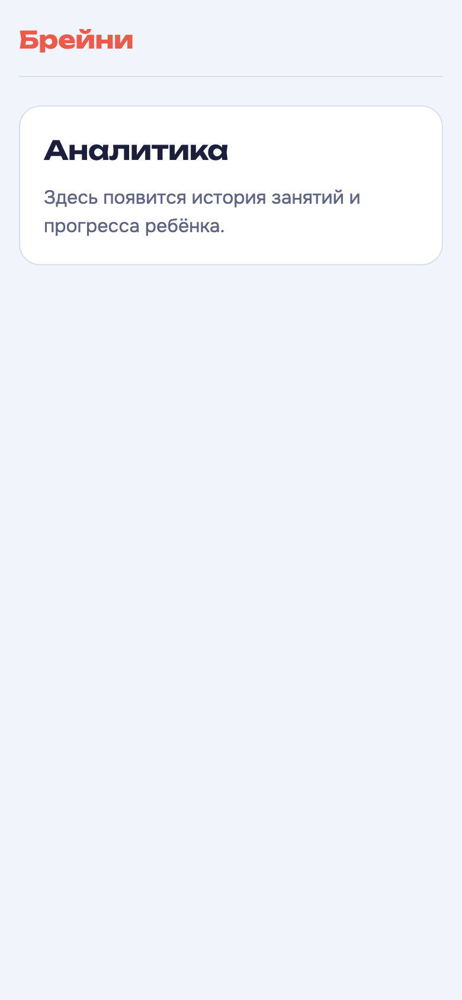
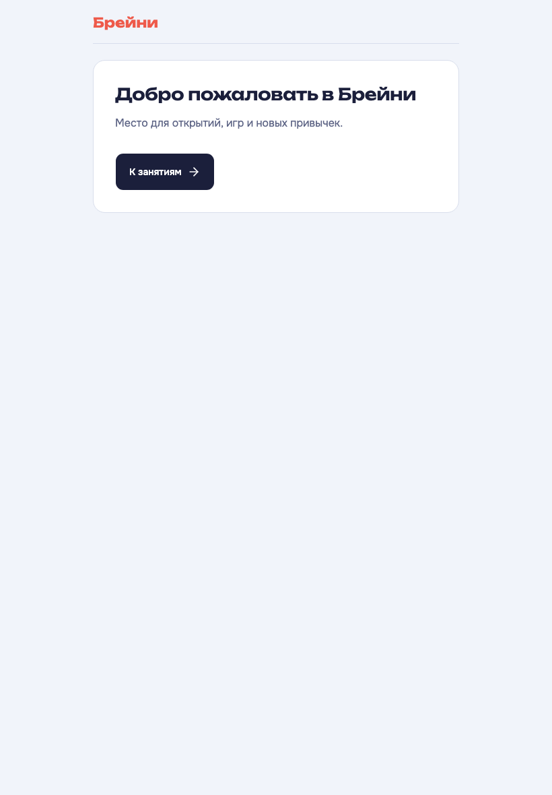
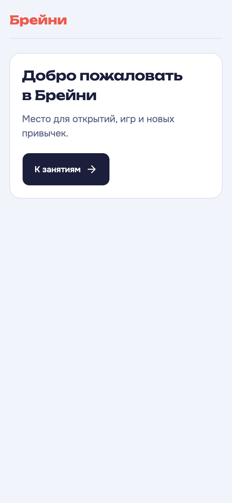

<!-- Generated by pnpm report --module scaffold. Edit docs/reports/src/scaffold.md. -->

# Brainee: starter screens and navigation

The current `/learn`, `/analytics`, `/login` and missing-page screens, recorded
from the local production build. These are scaffold placeholders: this report
does not demonstrate authentication, parent protection, games or rewards.
[Run instructions and source analysis](README.md).

## Recordings

Each continuous walkthrough starts at `/login`, follows "К занятиям" to
`/learn`, opens `/analytics` directly, then opens a missing route and follows
its return link. The analytics and missing-route visits use direct navigation
because the scaffold has no navigation between those screens yet. Checks cover
headings, Russian document language, loaded fonts and horizontal overflow.

### Phone · 390 × 844

**Phone: welcome, learning, analytics and 404 recovery** (flow `phone-walkthrough`): PASSED, 19 of 19 checks passed, 7.3 s, phone. Recorded Nov 14, 2026, 2:56 p.m. (Asia/Almaty) against `http://127.0.0.1:3123/login`.

Timeline: 33 entries

| Time | Source | Entry |
| --- | --- | --- |
| 00:00.050 | step | open /login |
| 00:01.620 | check | The welcome screen appears |
| 00:01.621 | check | The document language is Russian |
| 00:01.621 | check | The screen fits without horizontal scrolling |
| 00:01.621 | check | The two self-hosted font families load |
| 00:01.621 | step | call checkSurface |
| 00:01.621 | mark | Follow the welcome screen return link |
| 00:01.640 | step | click {"by":"role","role":"link","name":"К занятиям","exact":true} |
| 00:01.720 | check | The welcome link opens learning |
| 00:01.721 | check | The document language is Russian |
| 00:01.721 | check | The screen fits without horizontal scrolling |
| 00:01.721 | check | The two self-hosted font families load |
| 00:01.721 | step | call checkSurface |
| 00:02.522 | step | wait 800 |
| 00:02.522 | mark | Open the parent analytics placeholder directly |
| 00:04.063 | step | goto /analytics |
| 00:04.084 | check | The parent analytics placeholder appears |
| 00:04.084 | check | The document language is Russian |
| 00:04.084 | check | The screen fits without horizontal scrolling |
| 00:04.084 | check | The two self-hosted font families load |
| 00:04.084 | step | call checkSurface |
| 00:04.886 | step | wait 800 |
| 00:04.886 | mark | Open a missing route and return to learning |
| 00:04.900 | network (warn) | 404 GET http://127.0.0.1:3123/missing-page |
| 00:04.908 | console (warn) | Failed to load resource: the server responded with a status of 404 (Not Found) |
| 00:04.914 | check | The missing route returns HTTP 404 |
| 00:04.931 | check | The Russian missing-page screen appears |
| 00:04.933 | check | The document language is Russian |
| 00:04.933 | check | The screen fits without horizontal scrolling |
| 00:04.933 | check | The two self-hosted font families load |
| 00:05.796 | check | The 404 return link opens learning |
| 00:05.796 | step | call recoverMissing |
| 00:05.796 | check | The walkthrough ends on learning |

### iPad viewport · 820 × 1180

**iPad viewport: welcome, learning, analytics and 404 recovery** (flow `ipad-walkthrough`): PASSED, 19 of 19 checks passed, 7.5 s, ipad. Recorded Nov 14, 2026, 2:56 p.m. (Asia/Almaty) against `http://127.0.0.1:3123/login`.

Timeline: 33 entries

| Time | Source | Entry |
| --- | --- | --- |
| 00:00.041 | step | open /login |
| 00:01.589 | check | The welcome screen appears |
| 00:01.590 | check | The document language is Russian |
| 00:01.590 | check | The screen fits without horizontal scrolling |
| 00:01.590 | check | The two self-hosted font families load |
| 00:01.590 | step | call checkSurface |
| 00:01.590 | mark | Follow the welcome screen return link |
| 00:01.608 | step | click {"by":"role","role":"link","name":"К занятиям","exact":true} |
| 00:01.691 | check | The welcome link opens learning |
| 00:01.691 | check | The document language is Russian |
| 00:01.691 | check | The screen fits without horizontal scrolling |
| 00:01.691 | check | The two self-hosted font families load |
| 00:01.691 | step | call checkSurface |
| 00:02.493 | step | wait 800 |
| 00:02.493 | mark | Open the parent analytics placeholder directly |
| 00:04.045 | step | goto /analytics |
| 00:04.068 | check | The parent analytics placeholder appears |
| 00:04.095 | check | The document language is Russian |
| 00:04.095 | check | The screen fits without horizontal scrolling |
| 00:04.095 | check | The two self-hosted font families load |
| 00:04.095 | step | call checkSurface |
| 00:04.896 | step | wait 800 |
| 00:04.897 | mark | Open a missing route and return to learning |
| 00:04.903 | network (warn) | 404 GET http://127.0.0.1:3123/missing-page |
| 00:04.907 | console (warn) | Failed to load resource: the server responded with a status of 404 (Not Found) |
| 00:04.913 | check | The missing route returns HTTP 404 |
| 00:04.930 | check | The Russian missing-page screen appears |
| 00:04.931 | check | The document language is Russian |
| 00:04.931 | check | The screen fits without horizontal scrolling |
| 00:04.931 | check | The two self-hosted font families load |
| 00:05.797 | check | The 404 return link opens learning |
| 00:05.797 | step | call recoverMissing |
| 00:05.797 | check | The walkthrough ends on learning |

These recordings use Chromium at the named viewport sizes. The separate
`pnpm e2e` suite covers Chromium and WebKit; an iPad viewport is not evidence
of a real-device Screen Time test.

## Screenshots

### Learning

| iPad (820 × 1180) | Phone (390 × 844) |
| --- | --- |
|  |  |
| _learn_ | _learn_ |

### Parent analytics placeholder

| iPad (820 × 1180) | Phone (390 × 844) |
| --- | --- |
|  |  |
| _analytics_ | _analytics_ |

### Welcome

| iPad (820 × 1180) | Phone (390 × 844) |
| --- | --- |
|  |  |
| _login_ | _login_ |

## Logs and capture checks

[Download the flow timelines (JSON)](logs/scaffold.json). Each flow has timed
steps, checks, console errors, network failures and optional bridge messages.
Expected HTTP 404 and browser console messages for the missing route are
retained as warnings; the walkthrough checks that the response is exactly 404.

Captured Nov 14, 2026, 2:56 p.m. (Asia/Almaty): 6 scenarios, ipad and phone; Russian, light theme. No failed steps, redirects, JavaScript errors, HTTP errors or unexpected failed requests. 0 known lifecycle request cancellations remain in the manifest. Source: `2772388` with working-tree changes. Imported static references are not live captures. Flows: `phone-walkthrough` PASSED (19 checks), `ipad-walkthrough` PASSED (19 checks). Timelines: [JSON log](logs/scaffold.json).

The editable [template](src/scaffold.md), [scenario](../../scripts/reports/scenarios/scaffold.json)
and [walkthrough actions](../../scripts/reports/scenarios/scaffold.mjs) define
what this report captures. Raw contact sheet, PDF, screenshot manifest and
per-flow captures remain local under `docs/reports/.captures/scaffold/`.
